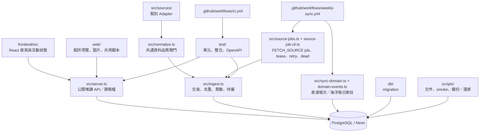
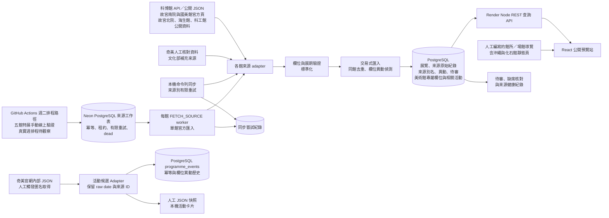
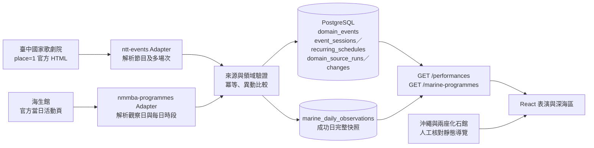

# Event Radar 架構：目前實作與目標方向

最後核對：2026-10-18。這份文件供作品展示與開發取捨使用；新接手者可先讀[開發導覽](development-guide.md)，資料關聯見[ERD](erd.md)。**目前實作圖包含 Render／Neon 公開技術預覽與已手動驗證的雲端來源工作；真正週排程尚待 2026-10-20 首次觸發驗收。下方 PNG 是未來構想，不代表已上線能力。** 特展搜尋與表演／海洋節目分流，一般市集、音樂節與講座不自動混入特展搜尋。

Phase 6 的[資料模型對照](domain-model.md)列出限期展、美術館、表演、海洋節目與奇美活動候選的共同來源概念和不同時間語意。第 025 migration 保證 `event_sessions` 只屬表演、`recurring_schedules` 只屬海洋節目；現階段仍是分領域查詢，沒有統一公開事件 API。

公開 OpenAPI 對表演與海洋節目使用分型回應，且各端點只接受自己的領域；契約測試會拒絕觀察日、場次與每日時段放錯位置。這是現有回應的格式驗證，不會把不同時間模型合併為單一時段。

Phase 3／4 的領域匯入：歌劇院官方 `place=1` 清單 HTML 的可辨識詳情（含 MORE 預藏卡片）經 `ntt-events` 轉成節目與多個 `event_sessions`；海生館官網當日節目經 `nmmba-programmes` 轉成節目與 `recurring_schedules`。兩者寫入 `domain_events`，由 `domain_event_changes` 留下變更、`domain_source_runs` 留下匯入結果，再由 `/performances`、`/marine-programmes` 供 React 查詢。歌劇院單批上限 30 筆；若 MORE 不再只展開同頁卡片便停止匯入。海生館大幅縮水批次會整批失敗，API 只顯示最近一次成功觀察到的節目。縮水保護與 19 筆合成歌劇院批次的隔離資料庫整合測試已於 2026-10-14 通過；當日真實手動同步兩次，第二次接受該篩選清單 20 筆（新增 1、未變 19）。歌劇院已接入**獨立 GitHub Actions 同步命令**並通過單次手動線上驗證，但不走 `FETCH_SOURCE` Queue；海生館**當日節目**仍按觀察日人工同步，不在每週工作中冒充今日時刻。特殊開館仍需官方日期證據與人工核對。

第 018 migration 起，歌劇院官方 `place=1` 清單使用獨立 `ntt_place1_list` 範圍；人工詳情與快照不影響官方筆數基準。成功基準至少 10 筆而新批次少於一半時，交易回滾並記錄失敗；人工核對後可附說明放行，理由寫入 `domain_source_runs.review_note`。舊節目不因清單缺席自動刪除或判定取消。

第 019 migration 再保存每次官方清單的來源鍵；前後清單至少各 10 筆而重疊不到較小清單的一半時，同樣拒收並要求人工覆核。這與筆數縮水共用交易保護與 `review_note`；舊批次沒有來源鍵，下一次成功同步先建立基準。

第 020／021 migration 為歌劇院場次加上來源或人工狀態、官方佐證及核對時的來源版本。官方詳情明示額滿時可標 `sold_out`；部分場次變更公告無法可靠對應個別場次時標 `unknown`，由本機命令逐場核對並留下異動歷史。相同來源版本重跑保留人工結果；來源內容改變則使舊結果失效。公開 `/performances` 回傳狀態來源及佐證，React 頁面分開呈現即將登場與所有場次。詳見 [Phase 3 階段紀錄](stage-2026-10-15-phase3.md)。

第 022 migration 將海生館**指定日期**的官方開／休館公告核對結果與異動另存，不混入當日節目或例行時間表。`/visit-status` 僅在該日有官方佐證與人工覆核時給確定狀態；其他日維持 `unknown`。10/15 官網當日節目仍有 9 筆，本機同步全未變。詳見 [Phase 4 階段紀錄](stage-2026-10-15-phase4.md)。

第 023 migration 再將海生館**成功匯入的完整當日節目清單**按觀察日及內容雜湊存入 `marine_daily_observations`，與最新 `domain_events` 更新共用交易。這是由正規化節目組成的歷史快照，並非原始網站鏡像；失敗或 `SOURCE_ANOMALY` 不寫入。無 `date` 的 `/marine-programmes` 仍查最新清單，帶 `date` 查該日最後成功版本，`/marine-observation-days` 列可查日期。舊日期不回填，且不得由每日節目推定未來時段或開館。

第 024 migration 擴充海生館官方每日清單的來源鍵基準與人工覆核證據。來源鍵大量更換或筆數大幅縮水時，匯入交易在更新事件與快照之前停止；站長核對館方頁並提供理由、官方網址與核對者後才可放行，核對結果存於同一筆 `domain_source_runs`。這是來源品質閘門，不更動公開 API 的節目狀態語意。

## 程式結構圖（目前實作）

下圖是 Repository 中各區域的**實際責任分工**，用來輔助閱讀程式；它和後面的資料流架構、以及最下方「目標架構概念圖」不同。完整檔案清單與閱讀順序見[專案結構地圖](project-structure.md)，核心型別、函式與設定見[程式導覽](code-reference.md)。

- `src/sources/` 只能放館方格式差異；共通展覽資料必須回到 `ExhibitionDraft`。
- `src/` 目前同層有 API、CLI 與服務模組，邏輯分組請依[專案結構地圖](project-structure.md#依責任閱讀-src)閱讀；為避免破壞命令、測試和工作流程，尚未進行只為美觀的大搬移。
- `db/` 是唯一資料庫結構入口；`frontend/` 與 `web/` 分別是互動首頁和人工維護的靜態導覽。
## 目前實作（公開技術預覽）

表演與海洋節目另走下列領域路徑；它們和上圖的 `exhibitions` 是分開的資料表及公開查詢端點。歌劇院的週工作直接執行 `sync:domain`，與特展的 `FETCH_SOURCE` Queue 不同。奇美活動候選同樣獨立，不是第三種公開節目 API。

`src/sync-source.ts` 可對限期展來源各自執行同步，暫時性錯誤最多嘗試三次，重試間隔為 30 秒、2 分鐘；`sync_attempts` 留下結果。科博館、故宮南院、海生館、科工館與國美館的五個特展工作，以及歌劇院獨立工作，已於 2026-10-17 通過手動線上 Actions 驗證。故宮北院在 GitHub runner 連線逾時，雲端工作獨立關閉，本機可人工同步；奇美文化部補充資料未納入每週工作。國美館的藝術家、策展人、展覽類型、展區及相關活動放在獨立美術欄位表，不把欄位硬塞進共通展覽表。資料無法確認展期或官方連結時進入待審，不進公開搜尋。匯入有交易回滾、同館跨來源保守去重與欄位異動紀錄；來源可能不完整，缺席只列候選，不自動下架。

官方清單完整度閘門以筆數與來源鍵變化判斷是否暫緩缺席流程。若館方確實換季，本機命令列可預覽新舊來源鍵，再由站長附官方證據更新後續比較基準；審查紀錄存在 `source_baseline_reviews`。這項操作不改展覽公開狀態，下次官方成功同步才重新評估。

網站由 `src/server.ts` 提供靜態頁面與 `/museums`、`/exhibitions`、`/exhibitions/:id/changes`、`/visit-status`、`/performances`、`/marine-programmes` 與 `/marine-observation-days` 等公開唯讀 API。特展可依城市、館所、日期、狀態及**明確標示免費**的資料查詢；關鍵字目前使用 `ILIKE`。14 篇館所／場館導覽是人工編寫的靜態頁，不是自動同步的展件清單。

本機 `sync:status` 與登入後的 `/health` 頁從同步嘗試、官方成功時間與待審量計算來源健康狀態；重試依 `sync_id` 歸為同一工作。PostgreSQL `FETCH_SOURCE` Queue 以同來源同日鍵防重，租約到期後由下一次 worker 領取流程回收；它只處理來源工作，沒有多階段解析或通知。GitHub Actions CI 執行文件、型別、單元、隔離 PostgreSQL 整合、OpenAPI 回應契約及合成資料備份還原檢查。Render／Neon 公開預覽已設定 `PUBLIC_BASE_URL`，網站地圖可讀、Search Console 已驗證、GA4 已收到自己的測試流量；不能稱為已有自然搜尋或外部訪客。六個來源工作雖已手動在線上執行成功，**真正週二排程與跨週穩定仍待觀察**；沒有主動告警。2026-10-18 正式 Neon 曾完成一次本機備份與隔離還原，仍無定期加密異地副本。詳見[目前進度](../STATUS.md)、[技術難點報告](technical-challenges-report.md)與[運作設計](operations.md)。

奇美活動候選走獨立的 `programme_events`，不寫入有非空展期約束的 `exhibitions`。目前只以本機人工命令從快照匯入資料庫（本次部署已匯入 Neon）；網站活動卡片仍讀靜態快照，並沒有從候選表對外提供活動 API。這讓後續美術館、表演與海生館 Domain 能以真實資料驗證模型後再收斂，不把來源特有欄位先硬塞共用表。

## 目標架構（概念圖，尚未實作）

這張長期概念圖保留原稿，圖內「系統架構圖」與「100+ 來源」等文字是**願景**，不是已完成聲明。部分流程與數字需要在實作前重新設計與驗證：

| 概念圖區塊 | 現況與展示方式 |
| --- | --- |
| Scheduler | GitHub Actions 週二工作已設定、六個獨立工作手動線上驗證成功；真正定時觸發與跨週穩定未驗證。故宮北院雲端工作獨立停用。 |
| Queue、Worker 並行、DLQ、Replay | Neon PostgreSQL `FETCH_SOURCE` 工作表有冪等、租約、有限重試、`dead` 狀態與人工重播；多階段 Queue 和通知 worker 未完成。歌劇院走獨立同步命令。 |
| Retry | 來源工作採有限重試及失敗紀錄；沒有概念圖中完整的多階段退避鏈。 |
| 原始資料與異動歷史 | 已保存來源原始紀錄與欄位變更；沒有完整 HTML 檔案庫或任意版本重播。 |
| 搜尋與索引 | 有日期索引及查詢 API；目前關鍵字為 `ILIKE`，不是已啟用的全文搜尋。現有資料量尚不足以證明新增複合索引有收益。 |
| 通知、訂閱、Email／LINE／Push | 尚未實作。 |
| Observability Dashboard | 有同步嘗試紀錄、來源健康、Search Console 與 GA4 測試訊號；沒有主動告警或完整遠端監控儀表板。 |
| 來源規模 | 五個特展來源及歌劇院工作通過線上手動驗證；北院人工同步，奇美候選／人工資料，不是 100 多個正式來源。 |

## 接下來的工程順序

目前已完成 Phase 9 的免費公開技術預覽，正做 Phase 10 的線上可靠性驗收：觀察第一次真實週排程與跨週來源結果、處理故宮北院的雲端連線例外、補強備份保留與告警、檢查行動版及收錄狀態。沖繩目前只有**人工核對的靜態導覽**，尚無跨國 Adapter；奇美仍是候選／人工來源。多階段 production Queue、通知與 AWS 留待需求和驗證成熟後評估。歷史階段與未完成項見[進度紀錄](../STATUS.md)和[後續路線](future-roadmap.md)。

每完成一階段，都應更新這份文件的現況、測試證據與概念圖標示，避免把設計目標誤寫成工作經驗。
