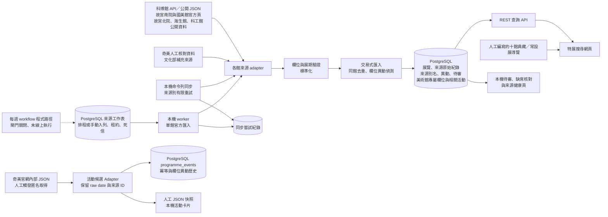
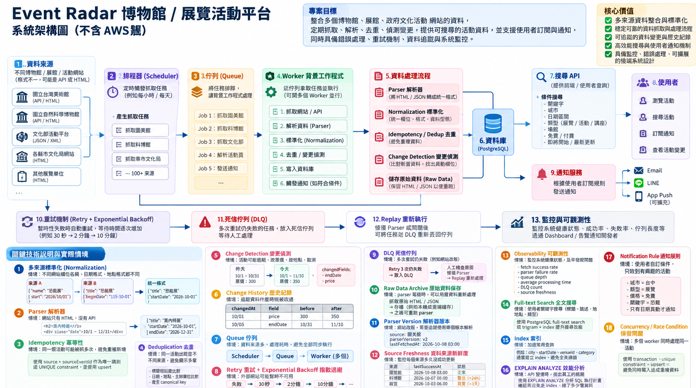

# Event Radar 架構：目前實作與目標方向

最後核對：2026-10-14。這份文件供作品展示與開發取捨使用；新接手者可先讀[開發導覽](development-guide.md)。**下方第一張圖以原有特展路徑為主；Phase 3／4 另有下述本機節目路徑。第二張是未來構想，不代表現有服務或已上線能力。** 特展搜尋與表演／海洋節目分流，一般市集、音樂節與講座不自動混入特展搜尋。

Phase 3／4 的本機手動 `sync:domain`：歌劇院官方 `place=1` 清單 HTML 的可辨識詳情（含 MORE 預藏卡片）經 `ntt-events` 轉成節目與多個 `event_sessions`；海生館官網當日節目經 `nmmba-programmes` 轉成節目與 `recurring_schedules`。兩者寫入 `domain_events`，由 `domain_event_changes` 留下變更、`domain_source_runs` 留下匯入結果，再由 `/performances`、`/marine-programmes` 供 React 查詢。歌劇院單批上限 30 筆；若 MORE 不再只展開同頁卡片便停止匯入。海生館大幅縮水批次會整批失敗，API 只顯示最近一次成功觀察到的節目。縮水保護與 19 筆合成歌劇院批次的隔離資料庫整合測試已於 2026-10-14 通過；當日真實手動同步兩次，第二次接受該篩選清單 20 筆（新增 1、未變 19）。這條路徑**尚未接 Queue 或線上排程**；海生館只代表當日觀察，特殊開館仍需人工核對。

## 目前實作（本機 MVP）

`src/sync-source.ts` 可對六個來源各自執行本機同步，暫時性錯誤最多嘗試三次，重試間隔為 30 秒、2 分鐘；`sync_attempts` 留下結果。新增的國美館來源仍由人手動觸發，尚未接入每週 Queue 工作或線上排程；奇美文化部補充資料亦未納入。國美館的藝術家、策展人、展覽類型、展區及相關活動放在獨立美術欄位表，不把欄位硬塞進共通展覽表。資料無法確認展期或官方連結時進入待審，不進公開搜尋。匯入有交易回滾、同館跨來源保守去重與欄位異動紀錄；來源可能不完整，缺席只列候選，不自動下架。

官方清單完整度閘門以筆數與來源鍵變化判斷是否暫緩缺席流程。若館方確實換季，本機命令列可預覽新舊來源鍵，再由站長附官方證據更新後續比較基準；審查紀錄存在 `source_baseline_reviews`。這項操作不改展覽公開狀態，下次官方成功同步才重新評估。

網站由 `src/server.ts` 提供靜態頁面與 `/museums`、`/exhibitions`、`/exhibitions/:id/changes`、`/visit-status` 等 API。可依城市、館所、日期、展覽狀態及**明確標示免費**的資料查詢；關鍵字目前使用 `ILIKE`。十館典藏／常設展頁是人工編寫的靜態導覽，不是自動同步的展件清單。

本機 `sync:status` 與登入後的 `/health` 頁從同步嘗試、官方成功時間與待審量計算來源健康狀態；重試依 `sync_id` 歸為同一工作。手動 PostgreSQL Queue 已能讓五館成為獨立來源工作，租約到期後由下一次 worker 領取流程回收；**每週 workflow 已接入單館 Queue，但閘門仍關閉**。這是本機排查與手動執行工具，沒有主動告警。GitHub Actions 的 CI 已執行型別、單元與 PostgreSQL 整合測試。每週同步 workflow 雖已寫好，仍受 `EVENT_RADAR_SYNC_ENABLED` 關閉；沒有遠端資料庫、公開網站或線上定期更新。詳見[目前進度](../STATUS.md)與[運作設計](operations.md)。

奇美活動候選走獨立的 `programme_events`，不寫入有非空展期約束的 `exhibitions`。目前只以人工命令從快照匯入本機 DB；網站活動卡片仍讀靜態快照，並沒有從候選表對外提供活動 API。這讓後續美術館、表演與海生館 Domain 能以真實資料驗證模型後再收斂，不把來源特有欄位先硬塞共用表。

## 目標架構（概念圖，尚未實作）

這張長期概念圖保留原稿，圖內「系統架構圖」與「100+ 來源」等文字是**願景**，不是已完成聲明。部分流程與數字需要在實作前重新設計與驗證：

| 概念圖區塊 | 現況與展示方式 |
| --- | --- |
| Scheduler | 有本機命令列同步與未啟用的每週 workflow；沒有已運作的線上排程。 |
| Queue、Worker 並行、DLQ、Replay | 已有本機 PostgreSQL `FETCH_SOURCE` 工作表、可並行領取、`dead` 狀態與人工重播；圖中的多階段 Queue、通知 worker 及線上服務仍未完成。 |
| Retry | 只有來源別程序重試，最多三次；沒有圖上的第三段 10 分鐘退避。 |
| 原始資料與異動歷史 | 已保存來源原始紀錄與欄位變更；沒有完整 HTML 檔案庫或任意版本重播。 |
| 搜尋與索引 | 有日期索引及查詢 API；目前關鍵字為 `ILIKE`，不是已啟用的全文搜尋。現有資料量尚不足以證明新增複合索引有收益。 |
| 通知、訂閱、Email／LINE／Push | 尚未實作。 |
| Observability Dashboard | 有同步嘗試紀錄、本機命令列健康報告與登入後只讀頁；沒有主動告警或遠端監控儀表板。 |
| 來源規模 | 六個來源可由本機命令各自同步，其中國美館只有首次單日核對；奇美另有人工／補充來源，並非 100 多個正式來源。 |

## 接下來的工程順序

目前按[11 階段優先順序](future-roadmap.md#2026-10-11-優先順序取代下方舊版擴館部署順序)進行：Phase 1 的來源可靠性未結項保留追蹤，Phase 2 已有國美館本機資料及模型，Phase 3／4 的歌劇院與海生館各有第一版本機路徑但尚未完整驗收；沖繩 Phase 5 依使用者指示暫停。完成共通模型、測試和文件後才公開部署；production Queue、每週排程與告警在部署穩定後啟用，AWS 留到課程進度足夠時。

每完成一階段，都應更新這份文件的現況、測試證據與概念圖標示，避免把設計目標誤寫成工作經驗。
