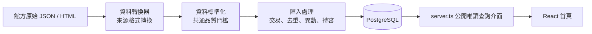

# Event Radar 程式導覽：核心變數、型別與函式

最後對照程式：2026-10-20（臺灣時間）。這份文件不是所有區域變數的逐行清單，而是把**影響資料正確性、公開查詢、同步與部署的名稱**集中說明，讓你能在面試或接手時說清楚程式在做什麼。資料夾位置先看[專案結構地圖](project-structure.md)，資料關聯看[ERD](erd.md)。

## 先記住四個層次

- **資料轉換器**：只知道某館的欄位、HTML 結構、民國年或內部 ID。
- **資料標準化**：只接受可公開的最低品質資料，例如官方 HTTPS 網址、有效日期、已知館別。
- **匯入處理**：管理「同一筆是不是重複、是否變更、失敗要不要整批復原、資料能不能公開」。
- **公開查詢介面／React**：只顯示已保存的結果，不重新猜日期或處理來源特例。

## 環境變數與設定（程式名稱保留原文）

真實值只放在本機 `.env`、Render／GitHub Secrets 或受 `.gitignore` 保護的 `private/`；範本在[`.env.example`](../.env.example)。

| 名稱 | 讀取位置 | 功能 | 面試可說的安全原則 |
| --- | --- | --- | --- |
| `DATABASE_URL` | 幾乎所有 DB 入口 | PostgreSQL／Neon 連線字串 | 只在執行環境保存，不進 Git、不出現在 log。 |
| `PORT`、`HOST` | `src/server.ts` | 公開 Node server 的監聽位置 | 本機預設 localhost；部署平台提供 port。 |
| `NMNS_API_KEY` | `src/nmns-api.ts`、`visit-status.ts`、`ingest.ts` | 科博館公開資料介面請求 | Key 只在後端；錯誤訊息不輸出含金鑰的請求網址。 |
| `NMNS_OPEN_DATA_URL` | `src/ingest.ts` | 科博館個人金鑰不可用時的官方公開 JSON 備援 | 備援只處理同一語意的展覽資料，不假裝能提供開館行事曆。 |
| `PUBLIC_BASE_URL` | `src/server.ts` | 產生標準網址、網站地圖與搜尋引擎連結 | 部署環境明確指定主網址，避免 Pages 與 Render 網址混用。 |
| `VITE_API_BASE_URL` | `frontend/src/runtime-url.ts` | 靜態 GitHub Pages 前端指向 Render 查詢介面 | 前端只接受 HTTPS 根網址；程式啟動時檢查格式。 |
| `VITE_BASE_PATH` | Vite build | GitHub Pages 子路徑，例如 `/event-radar/` | 讓資源與 hash 路由在子目錄仍可正確載入。 |
| `VITE_GA4_ID` | 前端 build | GA4 Measurement ID | 只放公開 measurement ID，不是資料庫或 API 密碼。 |
| `VITE_NOINDEX` | 前端 build | 公開預覽是否加上 `noindex` | 由部署階段設定，需和 SEO／Search Console 策略一致。 |
| `EVENT_RADAR_SYNC_ENABLED` | GitHub Actions 變數 | 全域開關每週同步工作流程 | 同步上線前先獨立驗證，避免提交程式後直接打所有館方來源。 |
| `EVENT_RADAR_NPM_NORTH_SYNC_ENABLED` | GitHub Actions 變數 | 故宮北院雲端同步獨立開關 | 北院在雲端曾逾時，不能讓單館例外拖垮其他工作。 |
| `EVENT_RADAR_CHIMEI_CHECK_ENABLED` | GitHub Actions 變數 | 奇美只讀連結核對開關 | 探測和正式匯入是兩件事。 |
| `EVENT_RADAR_ADMIN_PASSWORD` | `src/admin-server.ts` | 本機管理頁登入 | 管理頁不公開部署，密碼至少 16 字元。 |
| `EVENT_RADAR_BACKUP_DIR` | `scripts/db-backup.mjs` | 本機備份輸出目錄 | 預設 `private/backups/`，並以檔案權限與 Git ignore 保護。 |
| `RESTORE_DATABASE_URL` | `scripts/db-backup.mjs` | 隔離資料庫還原測試 | 程式拒絕還原到正式來源資料庫。 |

## 最重要的資料型別

### 限期展覽共通模型

| 名稱 | 檔案 | 它代表什麼 | 重要欄位／意義 |
| --- | --- | --- | --- |
| `ExhibitionDraft` | `src/normalize.ts` | 資料轉換器成功轉換後、準備寫入的共通展覽草稿 | `museumId`、`sourceKey`、`title`、`venue`、`startDate`、`endDate`、`sourceUrl`、`contentHash`、`isSample`。 |
| `ExistingExhibition` | `src/dedupe.ts` | DB 中可與新草稿比對的既有展覽 | 官方網址、標題、場地、展期和可見性，供保守去重。 |
| `ChangeField` | `src/dedupe.ts` | 可被追蹤的展覽欄位集合 | 標題、場地、日期、票價說明、官方網址、摘要。 |
| `ArtExhibitionDraft` | `src/sources/ntmofa.ts` | 國美館在共通展覽上加的美術欄位 | `artistNames`、`curatorNames`、`exhibitionType`、`venueArea`、`floor`、`relatedEvents`。 |

`contentHash` 是正規化後內容的 SHA-256，用於判斷來源內容是否變動；它**不是**來源授權或資料真實性的證明。`sourceKey` 是同一來源的穩定識別；有來源 ID 時用 ID，沒有時採官方詳情 URL。

### 表演與海洋：不共享錯誤的時間語意

| 名稱 | 檔案 | 為何需要獨立 |
| --- | --- | --- |
| `PerformanceEvent` / `PerformanceSession` | `src/sources/ntt-events.ts` | 一個歌劇院節目可有多個 `startsAt`、廳別、票價區間、售票狀態。 |
| `MarineProgramme` | `src/sources/nmmba-programmes.ts` | 海生館餵食／解說是指定 `observedOn` 的每日時段，不代表未來每天都同一時間。 |
| `DomainDraft` / `DomainScope` | `src/domain-events.ts` | 匯入時依 performance 或 marine 分流，並帶入清單範圍以檢查縮水。 |
| `VisitStatus` | `src/visit-status.ts` | 特定日期的開館／休館核對結果；未知就回 `unknown`，不由節目時段推論。 |

### 工作佇列、同步與來源健康

| 名稱 | 檔案 | 意義 |
| --- | --- | --- |
| `queuedSources` / `QueuedSource` | `src/source-jobs.ts` | 可以排進 `FETCH_SOURCE` 工作佇列的限期展館別白名單。 |
| `SourceJob` | `src/source-jobs.ts` | 工作識別碼、來源、排程日期、嘗試次數、狀態、租約。 |
| `JobOutcome` | `src/source-jobs.ts` | 工作執行器完成時回報成功、是否可重試、耗時與安全化錯誤訊息。 |
| `retryDelaysMs` | `src/retry-policy.ts` | 目前有限重試間隔：30 秒、2 分鐘。 |
| `CoverageResult` | `src/source-coverage.ts` | 官方清單筆數／身份鍵比對結果，判斷是否疑似清單縮水或替換。 |
| `HealthState` / `SourceFreshness` | `src/source-health.ts`、`source-freshness.ts` | 健康、過期、失敗、需人工核對等來源健康狀態。 |

## 核心函式：由資料進來到公開查詢介面

### 1. 資料轉換與標準化

| 函式 | 位置 | 做什麼 | 為什麼重要 |
| --- | --- | --- | --- |
| `normalizeNmnsFeed(payload)` | `src/sources/nmns.ts` | 驗證科博館 API 成功狀態與陣列、將日期轉交共通標準化 | 外部 JSON 不可信；先阻止格式變動滲入主資料。 |
| `classifyNpmNorthFeed`、`parseNpmSouthPage` | `src/sources/npm-*.ts` | 處理北院 JSON、南院 HTML、民國年與展期 | 不同館差異留在資料轉換器，不污染公開查詢介面。 |
| `classifyNtmofaPages(...)` | `src/sources/ntmofa.ts` | 解析國美館展覽及藝術專屬資料 | 展覽與藝術欄位是 1 對多／相關活動關係，不能扁平硬塞。 |
| `parseNttDetail(...)` | `src/sources/ntt-events.ts` | 從歌劇院詳情解析節目及多個場次 | 同一活動的多場次必須以 `event_sessions` 保存。 |
| `parseNmmbaProgrammes(...)` | `src/sources/nmmba-programmes.ts` | 解析海生館指定日節目 | 保留 `observedOn`，不誤導為永久時間表。 |
| `normalizeExhibition(row, expectedMuseum)` | `src/normalize.ts` | 驗證館別、標題、官方 HTTPS 網址、真實日期、日期順序與文字長度，產生 `ExhibitionDraft` | 所有來源共用的品質閘門，也是資料模型的邊界。 |

`normalizeExhibition` 的面試說法：**「資料轉換器處理館方格式；資料標準化檢查平台共通規則。」**

### 2. 匯入、去重、異動與交易

| 函式 | 位置 | 做什麼 | 失敗時的行為 |
| --- | --- | --- | --- |
| `fetchSource(url, host)` | `src/ingest.ts` | 設定識別用戶端、15 秒逾時、回應大小上限、HTTP 狀態與轉址主機檢查 | 拒絕非 2xx、轉向非官方主機或過大回應。 |
| `sourceRows(...)` | `src/ingest.ts` | 選擇各館資料轉換器，支援官方、檔案或快照模式 | 館別／來源不支援即停止，避免接錯解析器。 |
| `findStored(...)` | `src/ingest.ts` | 以來源 key、官方 URL 等找回 DB 裡同一筆展覽 | 確保重複執行不新增副本。 |
| `duplicateCandidates(...)` | `src/dedupe.ts` | 官方網址優先；否則以標題、場地、重疊展期找候選 | 只有候選，遇到歧義要停下待核對，不強行合併。 |
| `changedValues(previous, next)` | `src/dedupe.ts` | 產出欄位層級的 before／after 差異 | 可建立 `exhibition_changes`，支援延期、地點等異動追溯。 |
| `assessOfficialSourceCoverage(...)` | `src/source-coverage.ts` | 比較這次與基準清單的數量和身份鍵 | 清單突然大量變少時延後缺席處理，而不是直接下架。 |
| `trackMissingCandidates(...)` | `src/source-missing.ts` | 記錄上次出現、這次未出現的候選 | 「不見」只代表待人工核對，不直接等於取消。 |
| `importDomainEvents(...)` | `src/domain-events.ts` | 用交易寫入節目、場次或每日時段、異動與海洋快照 | 縮水／身份鍵異常時整批復原，不更新公開的最新成功資料。 |

`src/ingest.ts` 的 `main()` 是限期特展主入口：它建立 `ingestion_run`，取得來源，開啟資料庫交易，同館取得排他鎖，處理補正與來源紀錄，分流成新增／更新／未變／待審，寫入異動，最後提交或整批復原。這就是「**不是抓完資料就直接塞進資料庫**」的核心。

### 3. 工作佇列、重試與每週工作

| 函式 | 位置 | 做什麼 |
| --- | --- | --- |
| `taiwanDate(...)`、`validRunDate(...)` | `src/source-jobs.ts` | 讓工作鍵以臺灣日期計算、拒絕非法日期。 |
| `enqueueSourceJob(...)` | `src/source-jobs.ts` | 以來源＋日期建立唯一工作，重複執行不重複入列。 |
| `claimSourceJob(...)` | `src/source-jobs.ts` | 用工作憑證／租約取得一個可執行工作，避免兩個工作執行器同時跑同一筆。 |
| `finishSourceJob(...)` | `src/source-jobs.ts` | 根據 `JobOutcome` 標記成功、重試或停止重試。 |
| `replayDeadJob(...)` | `src/source-jobs.ts` | 人工確認原因後才把已停止重試的工作重新排入。 |
| `isTransientSyncFailure(...)` | `src/retry-policy.ts` | 只把逾時、暫時網路或伺服器 5xx 類情況視為可重試。 |
| `runScheduledSourceJob(...)` | `src/source-job-schedule.ts` | 將一個排程來源送入工作佇列並執行對應工作。 |

目前工作佇列的範圍是**一館一份 `FETCH_SOURCE` 工作**。它有重複執行保護鍵、租約、有限重試與停止重試後的人工重播；它還不是架構願景中的解析／通知／圖片多階段工作系統。

### 4. 公開查詢介面與 React 狀態

| 名稱 | 位置 | 意義 |
| --- | --- | --- |
| `json(...)`、`date(...)`、`numeric(...)` | `src/server.ts` | 查詢回應與網址參數的格式／範圍檢查。 |
| `withSearchStatus(...)` | `src/server.ts` | 依 `asOf` 計算展出中、即將開始、已結束等搜尋狀態。 |
| `backendUrl(path)` | `frontend/src/runtime-url.ts` | 讓 GitHub Pages 仍指向 HTTPS Render 查詢介面。 |
| `appUrl(path)` | `frontend/src/runtime-url.ts` | 以 Vite base path 建立前端內部連結。 |
| `Filters` | `frontend/src/main.tsx` | `q`、`city`、`museum`、`status`、`admission`、`asOf`、`includeSample` 的首頁搜尋狀態。 |
| `searchParams(filters, offset)` | `frontend/src/main.tsx` | 將 React 篩選狀態安全轉成查詢網址參數。 |
| `sourceMessage(museum)` | `frontend/src/main.tsx` | 將後端來源健康資料轉成使用者可理解的限制提示。 |
| `showBackToTop` | `frontend/src/main.tsx` | 在捲動超過門檻後顯示回頂操作；屬 UI 狀態，不影響資料同步。 |

## 一次「每週匯入」應如何講

1. `.github/workflows/weekly-sync.yml` 的每館 job 取得 Secret，不把 DB 密碼寫進 repository。
2. 排程工作執行 `npm run jobs:scheduled -- --source <館別>`；歌劇院因為有場次模型，改走 `npm run sync:domain -- --source ntt`。
3. 工作佇列用來源＋臺灣日期防止重複入列，工作執行器領取工作並取得租約。
4. 匯入程式使用該館資料轉換器，所有候選都經過共同驗證。
5. PostgreSQL 交易內執行去重、異動比較、來源完整度檢查與寫入；解析或品質閘門失敗就整批復原。
6. 成功、失敗、可否重試與錯誤摘要記入來源工作與同步紀錄；單一館失敗不把其他館的工作標成失敗。
7. 公開查詢介面只讀最近已成功保存的資料，前端再提示來源健康和人工核對邊界。

## 不該混淆的概念

| 名稱 | 正確意思 | 不該說成 |
| --- | --- | --- |
| 資料轉換器 | 將單一館方格式轉成平台模型的程式 | 通用爬蟲或所有來源共用的解析器。 |
| 資料標準化 | 平台共通的驗證、清理與欄位收斂 | 直接相信外部 JSON。 |
| 重複執行保護 | 同一來源資料重跑不重複建立展覽／工作 | 永遠不更新資料。 |
| 異動比對 | 同一識別資料的新舊欄位比較 | 自動判斷活動已取消。 |
| 待人工核對 | 不足以公開的資料或異常候選 | 已確認的展覽。 |
| 來源健康 | 最近同步、失敗與完整度訊號 | 館方內容絕對即時或完整。 |
| 工作佇列 | PostgreSQL 的來源工作隊列 | 已完成的多階段通知平台。 |
| 靜態導覽 | 人工核對的介紹、圖片、官方入口 | 自動同步的當期展覽。 |

## 修改前後最小檢查清單

- 改資料轉換器：至少補對應解析測試，並確認不會把館方私有欄位帶出轉換器。
- 改 `ExhibitionDraft`／資料庫：新增 migration、更新 API／OpenAPI、型別和整合測試。
- 改公開查詢介面：檢查輸入、OpenAPI 回應契約、React 型別與 `test:integration`。
- 改 Actions：先用 `workflow_dispatch` 跑單館，確認 Secret、DB、來源與 job 紀錄，再啟用排程。
- 改圖片／館所導覽：核對出處、授權與 `web/photo-credits.html`，不以第三方圖片當永久商業素材。
- 改文件：跑 `npm run check:docs`，並同步[技術決策](technical-decisions.md)、[來源盤點](sources.md)或[進度](../STATUS.md)。
