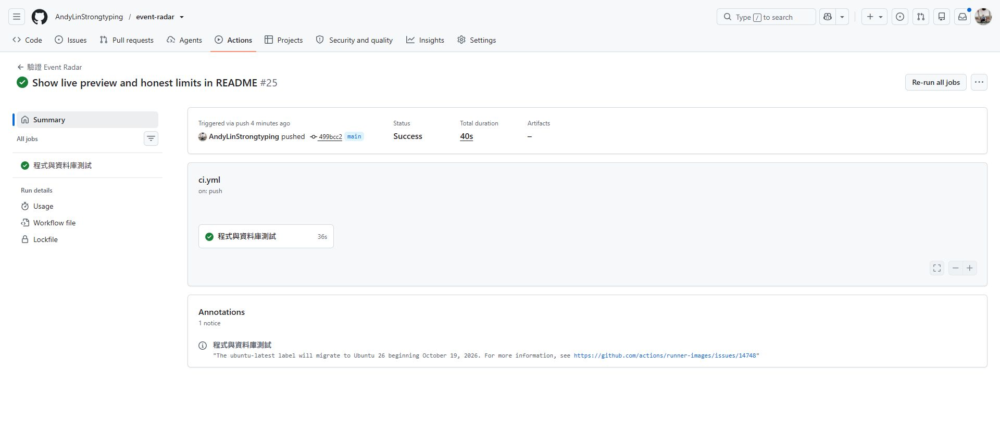
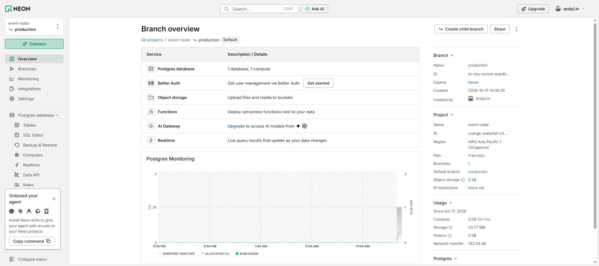
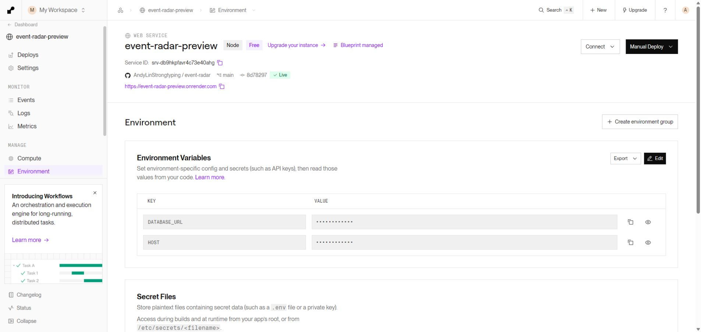
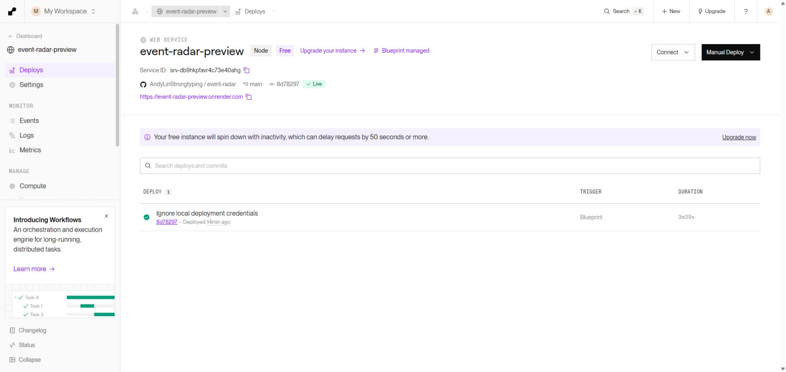
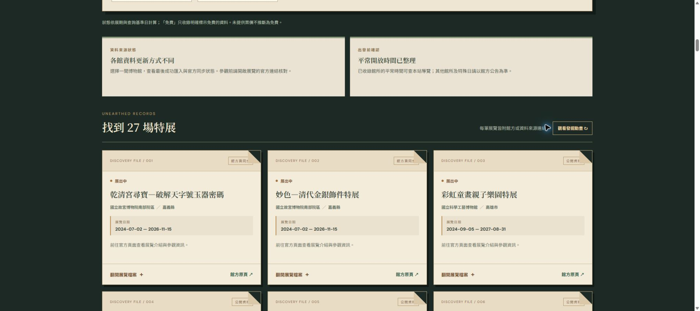

# Event Radar 圖解設定手順：Neon → Render

這份手順記錄 **2026-10-17 已完成的免費技術預覽部署**，並整理成日後重建時可以照做的順序。當前網站是 [event-radar-preview.onrender.com](https://event-radar-preview.onrender.com/)；公開可讀，但仍標示 `noindex`，沒有開啟雲端自動匯入或宣稱正式流量。以下畫面均取自實際帳號與網站，截圖中的資料庫密碼已隱藏。控制台介面日後可能改版，請以欄位名稱和檢查結果為準。

| 這次使用的資源 | 目前設定 |
| --- | --- |
| 程式碼 | [GitHub `AndyLinStrongtyping/event-radar`](https://github.com/AndyLinStrongtyping/event-radar)，`main` 分支 |
| 資料庫 | [Neon `event-radar`](https://console.neon.tech/app/projects/orange-waterfall-24843479)，`production` 分支，Singapore，`neondb` |
| 網站 | [Render `event-radar-preview`](https://dashboard.render.com/web/srv-db9hkpfavr4c73e40ahg)，Node / Free / Singapore，手動部署 |
| 本次驗收 | Render 執行版本 `8d78297`；25 份 migration；11 間館所、27 筆可搜尋特展 |

## 1. 先確認程式碼與測試

進入 GitHub 專案的 **Actions → 驗證 Event Radar**。綠色勾號代表該次提交的自動測試成功；它不代表 Render 已更新。這次截圖是文件提交 `499bcc2` 的 CI 成功畫面，網站當時仍執行較早的 `8d78297`，兩個版本要分開核對。



在本機專案根目錄可依序執行 `npm run typecheck`、`npm test`、`npm run check:docs` 和 `npm run build:web`。`npm run test:integration` 需要**隔離的本機 PostgreSQL／Docker**，不要把它指向 Neon 正式資料庫。詳細命令與環境條件見[部署手冊](deployment.md#上線前本機檢查)。

## 2. 建立 Neon 資料庫

用 GitHub 登入 Neon，建立獨立專案 `event-radar`；本次選 **Singapore**、免費方案，使用預設 `production` 分支與 `neondb` 資料庫。在專案 **Overview** 確認名稱、分支、區域和方案。下圖右側可看到這些設定。



按 **Connect** 取得 PostgreSQL **direct connection** 字串，確認有 `sslmode=require`。這串網址含密碼，只存入密碼管理器，或本機 Git 忽略的 `private/deployment-credentials.env`；不要貼到聊天、README、issue、終端輸出、截圖或 Git。這次依站長要求保留的本機檔案就是 `private/deployment-credentials.env`，`.gitignore` 已排除整個 `private/`。專案放在 OneDrive Desktop 時，Git 忽略不等於停止 OneDrive 同步；若不希望雲端同步，請自行把密碼移至密碼管理器。下載的 Neon `.env` 檔也含密碼，使用後要妥善保管。

> 若重新建立資料庫或重設密碼，舊連線字串立即失效；Render Secret 和本機私密檔都要一起更新。下圖刻意沒有展示 **Connect** 視窗，避免密碼出現在公開文件。

## 3. 先讓新資料庫有合規的展覽

這是**重建新環境時建議的順序**。在本機工作站先執行 migration，再從可連通且已驗證的官方來源匯入至少一筆未結束、日期完整的展覽，然後才建立 Render 公開服務。本次實際部署是在 Render 建置期間由本機先匯入科工館 7 筆，因此建置檢查才通過；Render 自己抓故宮北院時曾連續三次失敗。不能假定 Render 一定能直接連到所有館方網站。

在**專案根目錄**的 PowerShell 執行下列命令。它從本機私密檔讀取密碼到這個終端的環境變數，不會把密碼印出來：

```powershell
$secretFile = Join-Path (Get-Location) 'private\deployment-credentials.env'
if (-not (Test-Path -LiteralPath $secretFile)) { throw '找不到本機私密檔；請先從 Neon 安全取得連線字串。' }
$databaseLine = Get-Content -LiteralPath $secretFile |
  Where-Object { $_ -like 'DATABASE_URL=*' } |
  Select-Object -First 1
if (-not $databaseLine) { throw '私密檔缺少 DATABASE_URL。' }
$env:DATABASE_URL = $databaseLine.Substring('DATABASE_URL='.Length)

npm ci --ignore-scripts --no-audit --no-fund
npm run migrate
npm run sync -- --source nstm
npm run sync:status
```

`npm run sync:status` 要檢查來源成功時間、待審數及資料完整度。若科工館來源失敗，先查原因，或改用已驗證的其他來源；**不要塞示範假資料來通過建置**。程式的 `scripts/bootstrap-preview.mjs` 會在資料庫沒有可公開、未結束展覽時，再嘗試故宮北院、科工館與故宮南院；都失敗就拒絕發布空白站。這個保護不等於自動每日更新。

## 4. 從 GitHub 建立 Render 網站

在 Render 選 **New → Blueprint**，連結上述 GitHub repo，選 `main` 並匯入根目錄的 [`render.yaml`](../render.yaml)。建立前核對服務名稱 `event-radar-preview`、Node、Free、Singapore、**Auto Deploy 關閉**。範本會使用 `npm run start:prod` 啟動服務，並由 Render 注入 `PORT`。首次建置會依序建 React、套 migration、檢查是否有可公開展覽；migration 有帳本及鎖，重跑時不會重複套用。

進入服務 **Environment**，把 Neon 連線字串放進 `DATABASE_URL` Secret；`HOST` 應為 `0.0.0.0`。**不要設定 `PUBLIC_BASE_URL`**，先維持禁索引預覽。下圖可核對欄位名稱，但密碼值仍保持遮蔽。



Render 首次建置成功後，到 **Deploys** 查 `Live`、執行的 commit SHA 和公開網址。下圖是本次實際結果；即使 GitHub 後來有新提交，只要自動部署關閉，執行中的 SHA 仍以 Render 這頁為準。



## 5. 本機同步其餘來源，再驗收網站

這一版的 Render 服務**只提供公開頁面與讀取 API**。館方資料更新由本機工作站連 Neon 手動進行；沒有啟用 production Queue、每週排程或管理頁。保持同一個 PowerShell 視窗中的 `DATABASE_URL`，逐館執行六個限期展來源並查看每次結果：

```powershell
npm run sync -- --source nmns
npm run sync -- --source npm-south
npm run sync -- --source npm-north
npm run sync -- --source nmmba
npm run sync -- --source nstm
npm run sync -- --source ntmofa
npm run sync:status
```

海生館當日節目與歌劇院場次各自走 `npm run sync:domain -- --source nmmba`、`npm run sync:domain -- --source ntt`；海生館資料只代表**抓取當日**，不能當未來固定班表。奇美活動目前仍是人工核對快照的候選資料，不能稱為已完成自動來源。待審資料不會因部署自動公開。本次六館展覽同步後，線上預覽站顯示 27 筆未結束特展，畫面如下；筆數會隨展期與後續同步改變。



最後從專案根目錄執行唯讀檢查：

```powershell
npm run smoke:deploy -- https://event-radar-preview.onrender.com --expect-noindex
Remove-Item Env:DATABASE_URL
```

檢查涵蓋 `/health` 資料庫連線、React 資源、展覽與館所 API、館所介紹、化石圖片，以及預覽站的 `noindex`。正常輸出會列出當下館所與可搜尋特展筆數；本次為 **11 間、27 筆**。關閉或清除終端的 `DATABASE_URL` 後，密碼仍應只留在 Render Secret 與你選定的安全儲存處。

## 之後更新或正式公開時

- **只改文件／程式碼**：推送後先看 GitHub Actions；若要更新網站，再在 Render 手動部署，核對新 SHA 與 smoke 結果。不要把「CI 綠燈」當成「網站已更新」。
- **更新資料**：從本機逐來源同步並查看 `sync:status`、待審與來源健康；Render 沒有自動抓取。某來源失敗時保留舊資料，不因清單突然縮水大量刪除。
- **從預覽改成搜尋引擎可收錄的站**：先完成內容、照片授權、資料新鮮度和常駐服務評估，再設定唯一 HTTPS `PUBLIC_BASE_URL`，重部署並核對 sitemap、canonical 與 Search Console。這一步**尚未執行**，不能把目前的 `noindex` 預覽站當成已有自然搜尋流量。
- **帳號與費用**：兩個資源目前選免費方案；實際限制與未來費率依 Neon、Render 帳號頁為準。Render 免費服務會在閒置後休眠，首次讀取可能較慢，未完成跨週穩定性觀察。

資料流、故障回復及部署限制見[完整部署手冊](deployment.md)；設計原因見[ER-85～87](technical-decisions.md)。

若要向面試官說明這次部署的實際排錯與資料品質決策，可接著讀[部署問題與資料處理紀錄](deployment-lessons-2026-10-17.md)。
