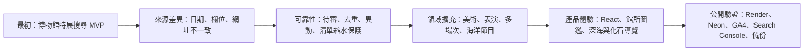

# Event Radar｜2026 年 10 月完整開發復盤

> 記錄期間：2026-10-04 至 2026-10-19  
> 核對基準：`main` 最新提交 `b608213`、公開 GitHub Actions、Render／Neon 單次驗收與本機測試紀錄。  
> 閱讀原則：本文會刻意區分「已實作」、「單次驗證」與「尚待觀察」。前者不會因為有規劃圖或本機畫面，就被寫成線上長期能力。

## 1. 這一輪到底完成了什麼

Event Radar 最初是「把幾間博物館的特展整理成可搜尋網站」的 MVP；完成這輪後，它已經成為一個有公開入口的資料整合技術作品：

- 將不同館方的 JSON、HTML 與人工核對資料，收斂成可查詢的展覽、表演與海洋節目資料。
- 不完整或可疑資料不直接公開，而是保留原始資料、待審原因、來源健康狀態與覆核入口。
- 以穩定來源鍵、交易、唯一約束及欄位差異紀錄，處理重跑、改期與來源清單縮水。
- React 首頁提供城市／館所／狀態／明確免費篩選，並將表演、深海與化石導覽分為不同內容區域。
- Render + Neon 已提供公開 API 與資料庫；GitHub Pages 提供快速載入的 React 介面與圖片。
- CI、OpenAPI 回應契約、隔離 PostgreSQL 整合測試與一次正式資料庫備份／還原演練都有可追溯證據。

公開入口有兩個角色：

| 入口 | 用途 | 現況 |
| --- | --- | --- |
| [GitHub Pages 快速入口](https://andylinstrongtyping.github.io/event-radar/) | 先由 CDN 載入 React 介面與公開圖片，適合分享與展示 | 已公開；資料仍需呼叫 Render API |
| [Render 主要網址／API](https://event-radar-preview.onrender.com/) | Node.js 唯讀 API、館所介紹頁、Neon PostgreSQL 的主要入口 | 已公開；免費服務休眠時可能冷啟動 |

截至 2026-10-19 的單次公開檢查，API 回傳 **11 間館所、25 筆未結束特展**，`/health` 顯示服務與資料庫皆正常。這是發布當下的觀測值，不代表資料完整率、固定流量、SLA 或長期可用性。

## 2. 需求如何演進

這個專案不是一開始就設定成「做很多館」。需求是從使用者問題往外長的，核心方向一直是：**寧可少顯示，也不要讓人看到不能確認的展覽資訊。**



### 需求上的重要收斂

1. **不把爬蟲當成技術主角。**
   重點改成多來源 Adapter、標準化、資料品質、冪等、變更偵測與可維運性。資料取得只是入口。
2. **不把所有資料硬塞成「展覽」。**
   美術展的人物欄位、歌劇院的多場次、海生館的每日節目有不同時間語意，因此分開建模與查詢。
3. **不把「缺資料」猜成「常設展」或「免費」。**
   展期不完整、來源網址不可核對、活動是否免費不明時，資料不進公開搜尋。
4. **不為了作品集宣稱未做完的 production 能力。**
   Queue、排程、備份、搜尋收錄、流量與部署都留下「實作到哪裡、驗證到哪裡」的界線。
5. **把畫面做成可理解資料邊界的產品。**
   館所圖鑑、票務、開館提醒、來源狀態與「出發前仍請確認官網」不是附屬文字，而是降低錯誤期待的一部分。

## 3. 開發時間線

### 10/04：從 MVP 到第一批可信資料

- 建立 Node.js、PostgreSQL 與查詢 API 的基本骨架，並加入考古主題的原始展示頁。
- 接入科博館、故宮北／南院、海生館等首批來源，開始保留來源網址與日期驗證結果。
- 依使用情境補進館所圖鑑、常設展示介紹、交通連結及圖片署名。
- 發現「選完城市仍顯示其他地區館所」不符合使用邏輯，修正成城市與館所連動篩選。
- 初步完成公開 API 契約與 local PostgreSQL 匯入驗證。

這階段最大的轉折是：來源資料品質比 UI 更先決定產品可信度。海生館資料就出現民國年、ISO 日期、空日期與內文日期混用，促成後續的原始資料留存與待審分流規則。

### 10/05：把資料品質流程明文化

- 加入本機待審／覆核工作流與原始來源紀錄。
- 科博館官方 OpenAPI 導入，並將 API Key 留在環境設定，不進 Git。
- 將 GitHub Actions 工作名稱改為繁體中文，讓 CI 執行畫面能直接當作課程與面試證據閱讀。
- 加入 OpenAPI 回應驗證與整合測試；修正測試伺服器、資料庫連線池與清除順序，避免測試結束時資料庫仍被占用。
- 增加展覽狀態與「來源明確標示的免費」篩選；不以票價未知推論免費。

### 10/10：資料可靠性成為後端主線

- 建立統一的架構、資料品質與技術決策文件。
- 顯示來源最後成功時間、同步失敗、待審數與資料新鮮度；新鮮度門檻由過短的 48 小時調整為符合每週更新情境的提示。
- 加入一般票價／購票入口，但把它明確定位為館所人工核對資訊，而非每一檔展覽的即時售票結果。
- React 首頁改成考古探索風格，加入資料載入時的「發掘文物」動畫與減少動態效果支援。
- 完成 PostgreSQL `FETCH_SOURCE` 工作佇列原型：同來源同日冪等鍵、租約、有限重試、死信狀態與人工 replay。
- 補上來源清單突然縮水、來源鍵大幅變動、零筆可公開資料等保護，避免把館方改版或暫時異常誤判成大量活動取消。

### 10/11：奇美、國美館與領域模型擴充

- 對奇美官網內部 JSON 端點完成探查：它不是館方公開文件化 API，匿名 Node 流程可取得部分頁面資料，但端點與 schema 穩定性不足以直接當作正式自動來源。
- 奇美改採「候選 Adapter + 人工刷新快照 + 本機候選表」；活動和限期展保持分流，不混入公開特展搜尋。
- 導入國立臺灣美術館，擴充藝術家、策展人、展覽型態與展區／樓層的獨立資料模型。
- 將來源清單異常、來源身分鍵變動及基準重設的覆核流程加入資料管線。
- 改成每週同步的產品節奏：不是即時交易資料，不需要用每日高頻輪詢換取看似新鮮但未驗證的資料。

### 10/12–10/16：處理不同領域的時間模型與產品分區

- 臺中國家歌劇院導入 `Event → EventSession[]`：節目可有多個場次、廳別、票價原文／範圍、購票連結與售票狀態。
- 海生館每日餵食、解說等節目採 `observedOn + recurring schedule` 模型，保存「成功觀察日」而不把它假裝成未來固定時間表。
- 建立「深海探勘」獨立區域，從陸地到海洋再到深海的視覺過渡；將海生館與沖繩美麗海分頁／切換呈現。
- 加入沖繩館所的人工靜態介紹、物種圖鑑與核心展區。這是導覽內容，不是已驗證的海外自動來源。
- 加入澎湖化石館與左鎮化石園區的「化石探勘」，處理圖片來源、可用範圍與署名；澎湖鱷照片改用有明確可用條件的政府來源並附註。
- P7 工程品質完成：資料庫 migration 順序與 checksum、防呆、單元、HTTP／資料庫整合、OpenAPI 契約驗證。
- P8 文件完成：README、架構、ERD、來源盤點、技術決策、操作手冊、面試簡報內容與路線圖同步。

### 10/17–10/18：從本機作品走到公開技術預覽

- 建立 Neon PostgreSQL、Render Web Service；用 Git 忽略的本機設定、Render Secret 與 GitHub Actions Secret 管理資料庫連線與科博館金鑰。
- Render 免費環境沒有可獨立使用的 pre-deploy shell，因此 build 流程按順序執行 React build、migration 與受控 bootstrap，避免發布空白資料庫網站。
- 首次雲端抓取故宮北院多次失敗，但沒有用假資料掩蓋；改由本機工作站用相同同步程式寫入 Neon，並保留雲端來源失敗紀錄。
- Search Console 以 HTML 驗證碼完成網站擁有權驗證；sitemap 讀到 15 個固定頁面。GA4 看到自己的測試事件，但不拿它當作外部流量。
- 每週工作流接入 6 個可用來源和歌劇院；故宮北院雲端工作由獨立開關關閉，避免它拖累其他來源。手動 Actions 證明 6 個工作可運行，尚未累積跨週排程證據。
- 收到手機長頁面不易回頂的真實回饋後，首頁與 14 篇館所介紹頁加入浮動回頂按鈕，並在公開站實測。
- 用 PostgreSQL 18.6 原生工具備份 Neon，還原到僅綁定本機的空白隔離庫。確認 25 份 migration、11 館、30 筆展覽與 18 筆匯入紀錄可重建。

### 10/19：處理免費後端冷啟動的展示體驗

- 品牌名稱與桌面長頁面跳轉導覽調整後，針對 Render 免費服務休眠造成的首次白屏問題，新增 GitHub Pages 靜態快速入口。
- React、CSS、JavaScript 和 28 張公開圖片由 Pages 載入；資料 API 與館所介紹頁仍指向 Render。
- 因為公開 API 沒有登入、Cookie 或寫入操作，使用明確的跨來源唯讀 CORS 契約；整合測試同步驗證。
- Pages 使用 `noindex,follow`，canonical 回到 Render，避免兩個入口競爭搜尋收錄。
- 第一次 Pages 工作因儲存庫未啟用 Pages 而在設定階段失敗；改為 GitHub Actions 來源後重跑成功。這個故障與修正保留在狀態／技術決策文件。

## 4. 核心架構與資料流

```text
官方 JSON／HTML／人工核對
        │
        ▼
來源 Adapter（來源格式只停留在這一層）
        │
        ▼
Parser + 日期／欄位驗證
        │                 └── 無法安全確認 → source_records 待審
        ▼
Normalized Exhibition／Domain Event
        │
        ▼
交易式匯入：唯一約束 + advisory lock + 來源別名
        │
        ├── exhibition_changes／session change history
        ├── coverage 與 source anomaly
        └── import attempt／最後成功時間
        ▼
PostgreSQL（Neon）
        │
        ▼
Node.js 唯讀 API（Render）
        │                   ▲
        └── React 搜尋頁（Render / GitHub Pages）
```

完整的目前實作圖見[架構文件](architecture.md#目前實作公開技術預覽)，資料表關係見[ERD](erd.md)，API 的可讀說明與機器可讀契約分別是[api.md](api.md)和[openapi.yaml](openapi.yaml)。

### 資料模型為什麼分三條路

| 領域 | 主資料 | 時間語意 | 不做的錯誤推論 |
| --- | --- | --- | --- |
| 限期特展 | `exhibitions` | `start_date` 至 `end_date` 的日期範圍 | 缺結束日不等於常設展；清單消失不等於取消 |
| 表演藝術 | `domain_events` + `event_sessions` | 每一場可有不同開始時間、廳別和售票狀態 | 有節目不等於有票；部分更動公告不自動判為取消 |
| 海洋節目 | `domain_events` + `recurring_schedules` | 成功觀察日 `observed_on` 的當日／週期時段 | 今天的餵食秀不保證明天或特殊日仍相同 |

這個拆分是這輪開發最重要的模型決策之一。若硬把表演場次或每日餵食時段塞入展覽的單一日期區間，前端看起來會簡單，但資料會在幾天後變成錯誤資訊。

## 5. 主要技術難點、決策與結果

### 5.1 多來源標準化：來源欄位不能污染全系統

不同來源用不同命名、日期格式與內容結構。實作上讓 Adapter 只負責理解來源，後續層只接受正規化模型。以奇美為例，`specialEvent`、`permanentEvent`、`expoEvent` 的欄位不同，這些名稱不會出現在共同資料模型或前端查詢契約。

**結果：** 新館接入的改動主要集中在 Adapter、來源驗證與測試；不會讓資料庫和 React 依賴館方私有欄位名稱。

**保留界線：** 奇美端點沒有公開 API 文件、回應格式與存取行為尚未跨週證明穩定，所以仍是候選來源。詳見[奇美評估](chimei-internal-endpoint.md)。

### 5.2 日期與資料完整度：不猜測

資料處理分為三個出口：

| 結果 | 條件 | 處理 |
| --- | --- | --- |
| 可公開搜尋 | 標題、館別、完整合法展期、官方 HTTPS 詳情皆可核對 | 正規化後寫入 `exhibitions` |
| 靜態／人工導覽 | 館方明確表述的常設展示或人工核對資訊 | 放入館所圖鑑，附官方確認連結 |
| 待審隔離 | 日期缺漏、日期矛盾、來源網址不可核對、欄位不完整 | 保留原始列與原因，不能出現在特展搜尋 |

**結果：** 使用者不會因為看到一筆不完整歷史資料，就被導向已結束或不存在的展覽。

**代價：** 公開結果數量會比館方原始清單少。這是有意識的產品取捨；待審數不代表漏了多少「當期展覽」。

### 5.3 冪等、去重與異動不是同一件事

每週重跑資料時，系統要回答三個不同問題：

1. 這筆是否已經匯入過？
2. 若是同一筆，資料有沒有真正變動？
3. 若來源清單少了它，是活動取消還是來源出錯？

因此使用來源 ID／官方詳情連結作為穩定身分鍵，資料庫以 `(museum_id, source_key)` 唯一約束；相同資料重跑只更新最後看見時間。只有標題、日期、地點、免費狀態、類型、說明或網址等欄位真的不同時，才建立 `exhibition_changes`。同一館的寫入以交易和 advisory lock 降低併發競爭風險。

**結果：** 可重跑不是「重複新增」，改期也不是「產生新展」。[技術難點報告](technical-challenges-report.md)保留了對應測試範圍與限制。

### 5.4 來源清單縮水：保護比自動下架重要

曾預期會遇到「昨天 30 筆，今天只剩 2 筆」的情況。可能原因有館方改版、篩選條件、網路錯誤或 parser 壞掉。若直接把少掉的 28 筆設為結束，會製造比資料延遲更嚴重的錯誤。

因此匯入會比對筆數和來源身分鍵。可疑批次標為 `SOURCE_ANOMALY` 或 `deferred_partial`，保留舊資料並暫緩缺席判定；正常清單中暫時沒出現的資料，也只先建立待人工核對的缺席候選。

**結果：** 系統願意暫時保留不確定性，而不是做不可逆的錯誤更動。

### 5.5 Queue：先解決每週少量同步的實際問題

沒有一開始加入 Redis 或 BullMQ。現階段工作量是每週少量館方來源，新增另一套基礎設施的成本大於收益，因此先以 PostgreSQL 工作表做 `FETCH_SOURCE`：

- 同來源同日的冪等鍵。
- worker 以 `FOR UPDATE SKIP LOCKED` 取工作。
- 三分鐘租約避免 worker 中斷後永久卡住。
- 有限重試、dead 狀態與人工 replay。
- 一館失敗不阻塞其他館。

**結果：** 這證明系統能處理來源失敗隔離與工作重複，不會把「有 scheduler」誤說成完整多階段事件平台。

**尚未完成：** `PARSE → NORMALIZE → CHANGE → NOTIFY` 多階段 queue、通知、Redis／SQS 與 production alert。詳見[運作設計](operations.md)。

### 5.6 表演、每日節目與海洋資料：讓時間保留原意

歌劇院的節目不是單一展期，因此使用 `EventSession[]`；場次可追蹤廳別、開始時間、票價原文或安全解析後的範圍、購票入口與售罄狀態。海生館節目則以成功觀察日保存，不宣稱隔天仍相同。

**結果：** API、資料庫和 UI 都能表達「一個節目有多場」與「這只是 10/15 觀察到的時段」等真實差異。

### 5.7 部署與復原：先證明資料能回來

公開部署把 React／Node 放在 Render、PostgreSQL 放在 Neon。Render build 中執行 migration 帶來一個明確風險：程式碼可以回退，schema 不一定能回退。因此在後續資料庫調整前，先完成一次正式 Neon custom-format 備份與隔離還原演練。

| 演練項目 | 已驗證結果 |
| --- | --- |
| 備份工具版本 | PostgreSQL 18.6，與 Neon 當時版本相容 |
| 資料保護 | 密碼只經子程序環境變數傳入；不在命令列或 Git |
| 還原位置 | 僅綁定 `127.0.0.1` 的獨立空白資料庫 |
| 還原核對 | 25 份 migration、11 館、30 筆展覽、18 筆匯入紀錄相符 |
| 尚未做的事 | 加密異地備份、週期輪替、自動還原演練、正式災難復原流程 |

詳情見[Neon 備份演練](stage-2026-10-18-neon-backup-drill.md)。

### 5.8 免費服務冷啟動：拆出快速前端，而不是假裝問題消失

Render 免費 Web Service 休眠時，原本 React、圖片和 API 全都要等後端喚醒。為改善分享與面試展示，React 編譯產物及公開圖片改由 GitHub Pages 提供，動態資料仍由 Render 讀取。

| 改善 | 沒有改善 |
| --- | --- |
| 首屏的介面、樣式、互動程式和圖片可由 Pages 立即載入 | 展覽資料仍需要 Render API 喚醒 |
| 分享連結不會先看到一片等待中的空頁 | 館所獨立介紹頁仍在 Render |
| 不增加資料庫或新付費服務 | 沒有變成高可用架構，也沒有保證 SLA |

這就是為何公開入口採 Pages、canonical 與 SEO 主站仍保留 Render。詳見[ER-95](technical-decisions.md#er-95靜態快速前端與休眠-api-分離保留同源站為-canonical公開環境已驗證)。

## 6. 這次遇到的真實問題與處理過程

| 問題 | 判斷與處理 | 產生的長期規則 |
| --- | --- | --- |
| 海生館與部分公部門資料日期缺漏或格式混用 | 不以 regex 猜補日期；保留 raw data、解析原因和待審 | 缺日期不能自動公開，也不能自動標常設展 |
| Render／GitHub runner 對故宮北院官方網址連線失敗 | 本機相同來源可 200，雲端診斷出 `UND_ERR_CONNECT_TIMEOUT`；隔離該館雲端排程 | 不能據此斷言館方封鎖；不使用未驗證第三方鏡像掩蓋問題 |
| GitHub Actions 曾出現 Neon `28P01` | 比對已下載環境設定與原 secret，確認是舊密碼；安全更新本機、Render、Actions 的 secret | 密碼不進 Git、截圖、命令列或操作紀錄；每個保存點需要明確盤點 |
| Render 免費服務無獨立 pre-deploy shell | 將 migration 與空庫 bootstrap 納入受控 build；無可公開資料時拒絕發布 | 任何 schema 變更先備份，且 migration 必須向後相容 |
| 長頁面手機操作不便 | 根據實際使用回饋加入浮動回頂按鈕，而非直接固定整個雙排導覽列 | 先用小而可驗收的 UX 改善回應真實回饋 |
| GitHub Pages 首次發布失敗 | 原因是 repository Pages 未啟用，不是 React build；改為 GitHub Actions source 後重跑 | 部署失敗要先辨識平台設定、建置或程式哪一層出錯 |
| 化石圖片版權與浮水印疑慮 | 不使用來源不明或新聞圖片作為永久素材；改用可追溯的政府來源並標註 | 圖片也要有來源與可使用範圍，不能因是示意圖就略過 |

部署過程與資料處理的原始紀錄在[部署復盤](deployment-lessons-2026-10-17.md)，每一個架構取捨則保留在[技術決策](technical-decisions.md)。

## 7. 品質保證、文件與可維護性

### 已接上的驗證

| 類別 | 做法 | 現況 |
| --- | --- | --- |
| 型別 | `npm run typecheck` 同時檢查後端 TypeScript 與 React | 已通過 |
| 單元 | `npm test` | 74 項通過的最近紀錄 |
| 整合 | 隔離 PostgreSQL + 真實 HTTP API 回應 | 已在 CI 驗證 |
| API 契約 | 公開 GET 回應與 `docs/openapi.yaml` 對照 | 已在 CI 驗證 |
| Migration | migration 帳本、順序、checksum 與 baseline 防呆 | 已有測試與線上 25 份 migration 證據 |
| 文件 | `npm run check:docs` 檢查 Markdown 連結 | 已通過；不驗證外部網址與頁內錨點 |
| 公開 smoke | health、資料 API、React bundle、圖片、館所頁 | 單次公開驗證已完成 |
| 備份／還原 | custom-format backup + 隔離空白庫 restore | 單次正式 Neon 演練已完成 |

### 文件不是附屬品

文件在這個專案有三種用途：

1. **面試可讀性：** [技術難點報告](technical-challenges-report.md)、[面試專案介紹](portfolio-brief.md)、[技術學習手冊](interview-study-guide.md)讓非專案作者能從問題、取捨和證據看懂作品。
2. **接手可維護性：** [開發導覽](development-guide.md)、[來源盤點](sources.md)、[運作手冊](operations.md)說明該從哪裡改、每一館目前是自動、候選還是靜態資料。
3. **避免文件與實作脫節：** 每次有技術變更都接續新增 ER 編號，且要求同一提交更新 STATUS／API／架構的必要部分。只有真的跑過測試或核對過外部環境，才能標「已驗證」。

## 8. 公開產品與使用者回饋的意義

這次上線不是為了立刻營利，而是讓作品開始取得真實運作證據。

- **Search Console：** 2026-10-17 已完成擁有權驗證，sitemap 已處理 15 個固定頁面；索引、曝光和點擊仍要等待後續資料。
- **GA4：** 已收到首頁與館所頁的測試 `page_view`／`session_start`，證明標籤載入；這些是開發者自己的測試，不是外部流量成績。
- **使用者回饋：** 浮動回頂按鈕是朋友實際使用長頁面後提出的問題，已轉成可測試、可部署的改進。
- **資料可信度：** 網站主動顯示來源狀態與官方確認入口。這比把更多不可靠資料塞進結果清單更符合產品責任。

## 9. 目前狀態：可以說什麼，不能說什麼

### 可以明確說

- Event Radar 已公開部署，React + Node.js／TypeScript + PostgreSQL 的完整資料路徑可實際操作。
- 已實作來源 Adapter、日期與欄位驗證、待審隔離、冪等匯入、欄位異動紀錄、清單縮水保護、來源健康資訊與公開唯讀 API。
- 已接入並驗證多種時間模型：限期展、歌劇院多場次、海生館觀察日節目。
- 六個雲端來源工作曾在 GitHub Actions 手動成功；故宮北院被隔離，不會使其他工作整批失敗。
- 已做一次 Neon 正式資料備份與隔離還原，並有 CI、OpenAPI、型別、單元與整合測試證據。
- 為改善免費服務冷啟動，已將前端外殼與圖片拆到 GitHub Pages，公開 API 保持在 Render。

### 不能誇大的項目

| 項目 | 正確說法 |
| --- | --- |
| 每週自動更新 | 已完成 workflow 和手動成功驗證；首次正式週二排程與連續跨週穩定仍待觀察 |
| 故宮北院 | 本機可同步；雲端 runner 連線逾時，因此自動排程目前獨立停用 |
| 奇美 | 有候選 Adapter、探查與人工快照；不是館方公開 API，也不是穩定自動來源 |
| 沖繩、化石館 | 有人工核對靜態導覽與圖鑑；尚非自動同步來源 |
| 資料即時性 | 採每週來源更新與人工核對，非即時票務／逐日開館服務 |
| 流量與 SEO | GA4 與 Search Console 已接好；尚無可宣稱的自然搜尋曝光、外部使用者或轉換資料 |
| 備份 | 有一次本機隔離還原演練；尚未形成加密異地、排程化的災難復原制度 |
| Queue 與通知 | 目前只有 PostgreSQL `FETCH_SOURCE` 工作；不是完整多階段 queue，也沒有 Email／LINE 通知 |
| 高可用 | Pages 改善首屏速度；Render 冷啟動與單一免費服務限制仍存在 |

最新逐項狀態以[STATUS](../STATUS.md)為準。

## 10. 從這輪開發得到的工程判斷

1. **資料正確性必須先於資料量。**
   產品面對的是出門前的資訊；錯一個展期可能讓使用者白跑。待審隔離並不是功能不足，而是系統拒絕捏造資訊的能力。
2. **先依工作量選架構。**
   每週少量館方同步先用 PostgreSQL Queue，原因是已有資料庫、可交易、可追查；等量與故障型態證明需要，再考慮 Redis、SQS 或更細的 worker 拆分。
3. **領域模型要服從資料語意。**
   展覽、演出和當日節目看似都是「活動」，卻不能共用同一個日期欄位就結束。分型模型反而讓前端與 API 更誠實。
4. **部署成功不是維運完成。**
   真正的下一關是跨週排程、來源改版、備份復原、冷啟動、索引與使用者回饋。這些證據比單次部署成功更能說明工程能力。
5. **免費基礎設施也值得處理體驗。**
   沒有預算升級常駐服務時，將靜態前端和動態 API 拆分，能用清楚的取捨改善第一眼體驗，而非掩蓋後端限制。
6. **文件要跟著決策走。**
   專案從「爬資料」發展成「公開資料產品」後，沒有 STATUS、來源等級、架構決策與操作手冊，就很容易在面試或未來維護時說不清楚。

## 11. 下一輪合理優先順序

這一輪結束後，最值得做的不是立刻加更多館，而是累積「真的在線上穩定運作」的證據。

1. 確認 GitHub Actions secret 與第一次正式週二排程，保存每館成功／失敗結果。
2. 至少觀察第二次週排程，確認不是只有一次手動成功。
3. 固定執行備份，並用同一份操作手順留下一次後續演練紀錄。
4. 持續看 Search Console 與 GA4，將分享連結加上 UTM；只在有足夠外部資料時才寫入履歷成果。
5. 依實際使用者回饋改善搜尋、導覽和資料狀態，而非一次擴充大量來源。
6. 在上述證據穩定後，再評估收藏、異動通知、訂閱、更多自動來源與付費／AWS 基礎設施。

## 12. 面試時的三分鐘版本

> 我做 Event Radar 的起點是博物館特展資訊分散，而且不同館方資料格式與日期品質差很多。我的重點不是單純爬網站，而是把各館來源放在 Adapter 後面，統一驗證日期、官方網址與館別。
>
> 可公開的展覽才會寫進 PostgreSQL；日期或來源不完整的資料保留原始內容進待審，不讓它直接出現在使用者搜尋結果。匯入以來源鍵和唯一約束保證重跑冪等，欄位變化會留下變更紀錄。若館方清單突然從很多筆變很少筆，系統會先標示來源異常，而不是直接把舊展全部下架。
>
> 後來我發現表演和海生館節目不能硬塞成展覽日期，所以歌劇院使用多場次模型，海生館使用成功觀察日的每日時段模型。部署後我也遇到免費服務休眠、雲端抓取故宮北院逾時、資料庫憑證過期等問題；目前以 GitHub Pages 提供快速前端，Render + Neon 提供 API 和資料庫，並完成一次正式資料庫的隔離備份還原。接下來重點是累積跨週同步和真實使用者回饋，而不是把尚未驗證的功能說成已完成。

## 13. 證據索引

| 類型 | 主要證據 |
| --- | --- |
| 目前狀態 | [STATUS](../STATUS.md) |
| 完整技術決策 | [technical-decisions.md](technical-decisions.md)（ER-1 至 ER-95） |
| 技術難點與測試邊界 | [technical-challenges-report.md](technical-challenges-report.md) |
| 架構、ERD、領域模型 | [architecture.md](architecture.md)、[erd.md](erd.md)、[domain-model.md](domain-model.md) |
| API | [api.md](api.md)、[openapi.yaml](openapi.yaml) |
| 資料來源與法律／使用邊界 | [sources.md](sources.md)、[chimei-internal-endpoint.md](chimei-internal-endpoint.md)、[ticketing.md](ticketing.md) |
| 部署與故障紀錄 | [deployment.md](deployment.md)、[deployment-lessons-2026-10-17.md](deployment-lessons-2026-10-17.md)、[deployment-walkthrough.md](deployment-walkthrough.md) |
| 備份還原演練 | [stage-2026-10-18-neon-backup-drill.md](stage-2026-10-18-neon-backup-drill.md) |
| 面試說明 | [portfolio-brief.md](portfolio-brief.md)、[interview-study-guide.md](interview-study-guide.md) |
| 後續工作 | [future-roadmap.md](future-roadmap.md)、[operations.md](operations.md) |

---

本文件是一次完整復盤，不會取代每日狀態紀錄。後續若有新的來源、線上排程、資料庫結構或部署模型變更，應在同一個提交同步更新 `STATUS.md`、對應 ER 決策與本文件的「目前狀態／下一步」段落，讓復盤維持可追溯性。
