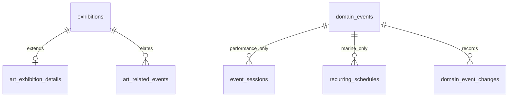

# Phase 6｜展演資料模型收斂

最後核對：2026-10-16。本文件描述**目前本機已實作的模型**，不是已部署的統一事件搜尋。來源先經各自 Adapter 驗證，再進入對應領域的資料表；共通概念在 API 與文件層對齊，不強迫所有資料共享一張充滿空欄位的表。

| 領域 | 主資料及識別 | 時間語意 | 專屬資料 | 公開查詢 |
| --- | --- | --- | --- | --- |
| 博物館限期展 | `exhibitions`；同館 `source_key`，另由 `exhibition_sources` 連結提供者 | 經驗證的 `start_date`／`end_date` 範圍，兩者必填 | 票務和展期；缺日期的來源紀錄隔離待審 | `/exhibitions` |
| 美術館限期展 | 沿用 `exhibitions` 識別與展期 | 同博物館限期展 | `art_exhibition_details` 的藝術家、策展人、展覽類型、展區／樓層；`art_related_events` 保存相關講座／導覽連結 | `/exhibitions` 與詳情中的美術欄位 |
| 表演節目 | `domain_events`，`domain='performance'`；`source_id + source_key` | 一個節目有多筆 `event_sessions.starts_at`；每場有廳、價格及有證據的狀態 | 場次狀態的來源、人工核對證據與來源版本 | `/performances` |
| 海生館當日節目 | `domain_events`，`domain='marine'`；`source_id + source_key` | `observed_on` 是館方當日頁觀察日期；`recurring_schedules` 是該次觀察的本地時段，不是未來每日保證 | 成功批次的 `marine_daily_observations` 完整快照；指定日期特殊開館另存人工核對表 | `/marine-programmes`、`/marine-observation-days` |
| 奇美活動候選 | `programme_events`；館所、提供者、來源類型及來源 ID | 保留 `raw_date` 與 `schedule_type`；僅安全的單一展期才有起訖日期 | 多日期、即日起、僅時間或未知日期，不推成限期展 | 尚無公開活動搜尋 API；本機候選資料 |

共通核心是**可追溯來源身分、標題、館所或場地、來源網址、取得時間及內容異動**。這些是概念契約，不代表目前有一張統一 `events` 表或可跨領域排序的公開 API。各領域採不同時間模型：`end_date`、逐場 `starts_at`、當日 `observed_on + local_time` 不可互換；`unknown` 場次狀態亦不可解讀為取消。

第 [025 migration](../db/025_domain_child_integrity.sql)在 `domain_events(id,domain)` 建立複合參照鍵；表演場次帶固定 `performance`、每日時段帶固定 `marine`，各以複合外鍵指向正確領域的父節目。既有匯入仍只提供 `event_id`，固定 domain 由資料庫預設填入。這同時阻止已有子資料的父節目被改成另一領域，且沒有把 `ntt`／`nmmba` 等目前來源寫死在模型中，往後同類型來源可以沿用。**資料庫約束只防錯誤關聯，不保證來源資料正確或跨週穩定。**

目前匯入入口另要求 `ntt → performance`、`nmmba → marine`；這是**現有兩個 Adapter 的執行時契約**，不是資料庫永久限定來源。新增同類來源時須先新增來源 Adapter、範圍規則與測試，不能直接繞過入口把未驗證資料送入通用表。

公開回應的 `DomainEvent` 契約在 [OpenAPI](openapi.yaml) 用 `oneOf` 明確分成 `PerformanceEvent` 與 `MarineProgramme`，兩個查詢端點各自只接受對應清單。表演的 `observedOn`、`dailySchedule` 必須為 `null`，海洋節目的 `sessions` 必須為 `null` 且 `observedOn` 是有效日期。這是現有 JSON 的契約加嚴，沒有變動 API 回傳格式；契約測試會拒絕錯領域資料或把時間欄位放錯的回應。

後續若要做跨領域搜尋，先定義清楚型別化的結果與時態：展期、單一場次、當日觀察需分別帶時間種類、來源品質和導回官方的網址。不能只用一組可空 `startAt/endAt` 抹平差異。沖繩目前只有人工核對的靜態導覽與節目線索，並未寫入領域資料表；`sourceLanguage`、`Asia/Tokyo` 的匯入語意仍未驗證，不加入現行共通欄位。
