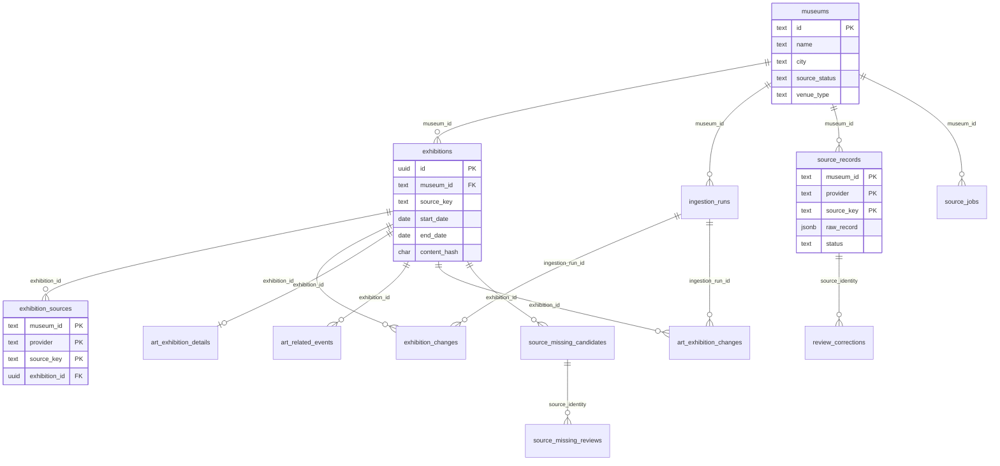
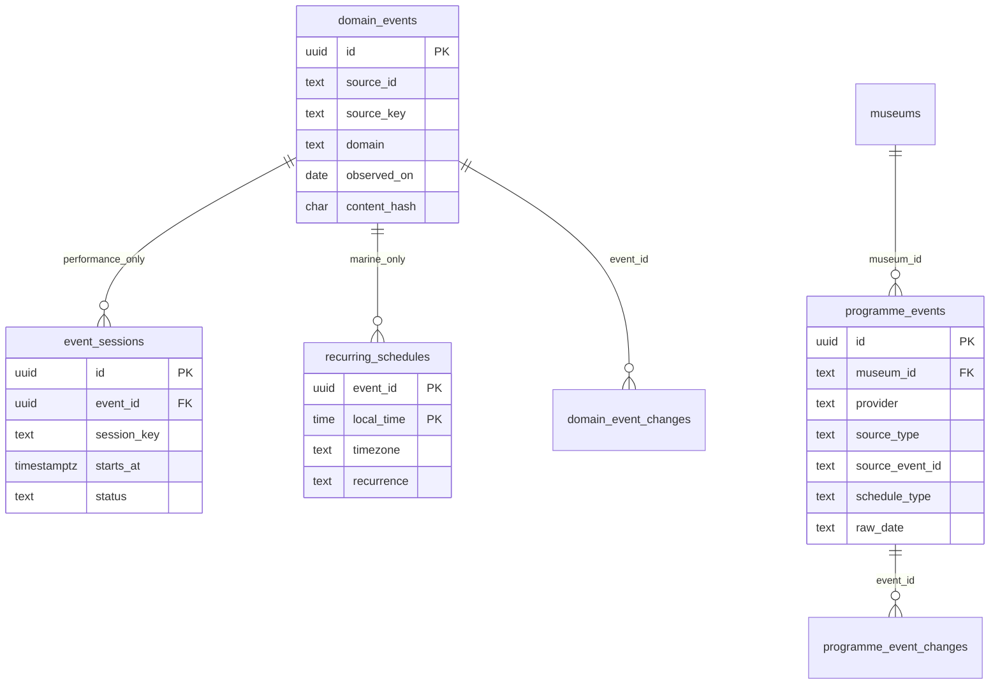

# Event Radar｜資料庫 ERD（本機已實作）

最後核對：2026-10-16。此圖依 `db/001`～`025` migration 描述主要資料關係，省略純查詢索引、時間戳、部分審查輔助欄位與 migration 帳本。箭頭只代表**實際外鍵**；來源 Adapter 到資料表的程式關係不畫成外鍵。領域時間語意另見[模型對照](domain-model.md)，執行路徑見[架構圖](architecture.md)。

## 限期展、美術館與來源審查

`exhibitions` 的 `(museum_id,source_key)` 唯一；`exhibition_sources` 的 `(museum_id,provider,source_key)` 為同館不同提供者的來源身分。日期範圍必須完整且 `end_date >= start_date`。不合格來源留在 `source_records` 待審，不由缺日推斷常設展。美術欄位放在一對一 `art_exhibition_details`，相關講座／導覽是 `art_related_events` 的連結，不是已確認可報名場次。缺席候選與人工審查不直接刪除展覽。

## 表演、海洋節目與奇美候選

`domain_events` 以 `(source_id,source_key)` 去重；第 [025 migration](../db/025_domain_child_integrity.sql) 的複合外鍵要求 `event_sessions` 只能連 `domain='performance'`，`recurring_schedules` 只能連 `domain='marine'`。表演逐場 `starts_at` 與海洋節目 `observed_on + local_time` 不互相替代。

`domain_source_runs` 保存領域來源批次，`marine_daily_observations` 以 `(source_id,observed_on,snapshot_hash)` 保存成功日完整快照；兩者目前**沒有指向 `domain_events` 的外鍵**，故不在圖上畫關聯。奇美 `programme_events` 以 `(museum_id,provider,source_type,source_event_id)` 唯一，保留原始日期和保守解析的 `schedule_type`；它是本機候選資料，尚無公開活動搜尋 API。

## 運作邊界

`source_jobs` 是本機 `FETCH_SOURCE` 工作表，不是多階段訊息佇列。`sync_attempts`、`official_source_baselines`、`source_baseline_reviews` 與 `museum_opening_exceptions` 分別保存嘗試、完整度、人工放行及有證據的特殊開館核對；它們不改變上述三種時間模型。所有表的完整欄位、索引及約束應以 [migration](../db/001_init.sql) 和後續 SQL 為準。
