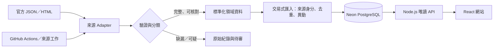

# Event Radar｜面試技術學習手冊

核對日：2026-10-18。本手冊以目前 repo 的程式和[進度證據](../STATUS.md)為準。先讀[30 秒與 2 分鐘講稿](portfolio-brief.md)，再按本頁走一筆資料。目標不是背術語，而是能回答「問題是什麼、為何這樣設計、程式如何保證、失敗時怎麼辦、目前證明到哪裡」。

## 先建立全貌

Event Radar 有四種不同的東西，面試時不要混在一起：**取得資料**（對方的 JSON／HTML）、**判斷資料可信度**（Adapter、驗證、待審）、**保存和查詢**（PostgreSQL、API）、**展示**（React、靜態導覽）。排程及 Queue 是啟動匯入的方式，不是資料正確性的保證。



**一句白話**：官網說「有這個活動」只是輸入；本站要確定它屬於哪間館、何時舉辦、是否與舊資料同一筆，才決定能不能讓訪客看到。

## 用一筆資料走完整流程

以下「某館恐龍特展，2026-11-01 至 2027-03-31」只是教學示意，**不是本站的真實展覽**。

1. **抓取**：該館 Adapter 讀官方 JSON 或公開 HTML。這一步只能證明「抓到了字串」，還不能證明展期正確。入口在 `src/ingest.ts`，各館解析在 `src/sources/`。
2. **解析與驗證**：Adapter 將館方欄位轉成本站欄位。`src/normalize.ts` 驗證館別、標題長度、`YYYY-MM-DD` 的真實日期、結束日不早於開始日、該館允許的官方 HTTPS 主機。`2026-02-30` 會被拒絕；不會由「即日起」猜開始日。不同來源可有自己的日期解析，但限期展進庫前仍要滿足共同驗證。
3. **分流**：完整紀錄成為可匯入的展覽；缺日期或無法核對的來源紀錄保存為 `source_records` 的 `review`，不進公開搜尋。明確不屬於本館限期展的資料可標 `ignored`。這不是「抓不到就丟掉」，而是保留追查線索。
4. **識別同一筆**：優先用穩定來源 ID／官方詳情網址組成 `sourceKey`。同館同來源鍵由資料庫唯一約束保證不會產生第二筆。若不同提供者指向同館同展，先按官方網址，必要時再用展名、展廳與展期重疊保守判斷；模糊匹配超過一個候選便失敗待查，不任意合併。
5. **比較變更**：第一次插入 `exhibitions`。隔週同一筆未變，只更新最近看到時間。若展期從 3/31 改成 4/30，更新展覽並在 `exhibition_changes` 記錄 `end_date` 的舊值、新值及所屬匯入批次；`content_hash` 協助辨識內容版本，但不是活動身分。
6. **交易與完整度**：同批寫入展覽、來源別名、待審與異動，在 PostgreSQL 交易內執行；意外寫入錯誤會 rollback。若官網整張清單突然由 30 筆變 2 筆，不直接認定其餘 28 筆取消。程式先評估來源筆數與來源鍵變化，暫緩**缺席判定**，保留舊展供人工核對。這個閘門並非一律拒絕新批次：有效新展仍可能匯入，缺席流程被延後。
7. **查詢與展示**：`GET /exhibitions` 依城市、館所、日期、狀態及明確免費資訊篩選。回應附官方連結，網站顯示來源狀態；館方官網仍是出發前確認展期、開館與票務的依據。

請能不看文件，自己用「昨天 3/31、今天 4/30、官網只回兩筆」重新講出第 4～6 步。這比背「我用了 hash、upsert、Queue」更有說服力。

## 核心技術 1：Adapter、驗證與 Normalization

**問題**：一館用 JSON，另一館用 HTML；日期可能是西元、民國年、混有 HTML 或只有「即日起」。若 API、資料表、前端都認識來源專屬欄位，來源一改版就到處壞。

**決策**：把來源格式限制在自己的 Adapter。限期展進共同模型前要通過嚴格驗證。美術館的藝術家和策展人另存在 `art_exhibition_details`，不把每種來源的特殊欄位塞進 `exhibitions`。

**要懂的差別**：

- **Parser** 把字串讀成欄位；**Normalizer** 把各來源欄位轉成同一語意；**Validator** 拒絕不合規值。三者可以在同一程式路徑執行，但責任不同。
- `rawDate` 是來源原話；`startDate/endDate` 是經確認後的日期。保留原話，才能回頭檢查解析是否錯誤。
- `null` 或 `unknown` 是誠實表達不確定。沒有結束日**不等於**常設展；沒有票價**不等於**免費。

**實作定位**：[標準化](../src/normalize.ts)、[來源盤點](sources.md)、[領域模型](domain-model.md)。奇美內部 JSON 的 `specialEvent`／`permanentEvent`／`expoEvent` schema 不同，目前仍是候選 Adapter 和人工快照，不是可靠的自動公開活動來源。

**面試回答**：「我不讓來源 JSON 直接成為主資料表。Adapter 負責解析差異；公開限期展一定要有可驗證的起訖日與來源網址。無法判定的資料留在待審，避免使用者白跑一趟。」

## 核心技術 2：Idempotency、去重、異動偵測

這三個概念相關但不相同：

| 概念 | 要回答的問題 | 本站做法 |
| --- | --- | --- |
| 冪等 | 同一匯入重跑，會不會多出第二筆？ | 穩定來源鍵、`UNIQUE`、`ON CONFLICT`／既有紀錄查找；Queue 同來源同日也有 `idempotency_key`。 |
| 去重 | 不同來源列會不會其實是同一場？ | 同館官方詳情網址優先，其他情況保守比對並保留 `exhibition_sources`；不跨館亂合併。 |
| 異動偵測 | 同一場的內容有沒有改？ | 比較具體欄位、更新資料並存 `exhibition_changes` 舊／新值；相同內容重跑不增歷史。 |

**為何只用 title 當 key 不行？** 巡迴展、同名年度展、改名都會撞到。**為何只用 hash 當 key 不行？** 日期改了，hash 也改，系統會誤以為是新活動。來源身分與內容版本必須分開。

**如何應對同時匯入？** 限期展匯入用交易、資料庫唯一約束，且以同館的 transaction-level advisory lock 限制同館併發寫入。不能只靠應用程式先查再插，因為兩個程序可能同時查到「不存在」。

**實作定位**：[限期展匯入](../src/ingest.ts)、[基本結構與唯一約束](../db/001_init.sql)、[來源別名與變更](../db/002_sources_and_changes.sql)。

## 核心技術 3：來源清單異常與人工待審

**情境**：昨晚官方清單有 30 筆，今天只回 2 筆。可能是展覽真的換季，也可能是網站改版、API 分頁、Filter 行為變更或解析器壞掉。只靠「今天沒抓到」就刪除 28 筆是錯誤結論。

**本站分兩層處理**：逐筆缺日期等問題進 `source_records` 待審；整批清單筆數或來源鍵異常時，`coverage_status=deferred_partial`，暫緩舊展的缺席候選變動。正常完整清單中某筆真的缺席，也先記 `source_missing_candidates`，不自動視為取消或下架。站長可依官方頁留下覆核證據；覆核只改比較基準，不憑空產生館方取消公告。

**例外要講精準**：若整批抓取／寫入失敗，交易 rollback；若官網有資料但 0 筆通過公開展覽驗證，會保存原始／待審紀錄並將批次記為失敗，不更新官方成功時間。若來源清單「疑似部分缺漏」，可接受有效展覽，但暫緩缺席判定。這些不是同一種錯誤。

**實作定位**：[匯入流程](../src/ingest.ts)、[來源完整度設計](operations.md)、[缺席候選表](../db/009_source_missing_candidates.sql)。

## 核心技術 4：為何不用單一 `events` 表

| 領域 | 真正的時間語意 | 表與限制 |
| --- | --- | --- |
| 限期展／美術展 | 明確的開始日、結束日 | `exhibitions`；缺日期不進公開搜尋，美術欄位由一對一擴充表保存。 |
| 表演 | 一個節目有多個日期、時刻、廳別和狀態 | `domain_events` + `event_sessions`；`scheduled` 不表示尚有票。 |
| 海生館當日節目 | 某個**觀察日**看到的本地時段 | `domain_events` + `recurring_schedules` + 成功日快照；不保證未來每日照表演出。 |
| 奇美活動候選 | 原始日期可能是多日、即日起、僅時間或未知 | `programme_events` 保留 `raw_date`／`schedule_type`；未提供公開活動搜尋 API。 |

若把它們全塞進一張表的 `start_at/end_at`，海生館「今天 15:00 餵食」可能被錯誤解讀成「未來每天 15:00」。模型分開後，API 也分 `/exhibitions`、`/performances`、`/marine-programmes`。第 025 migration 用複合外鍵保證表演場次不能掛在海洋節目，反過來也一樣。

**實作定位**：[領域模型](domain-model.md)、[ERD](erd.md)、[領域子表約束](../db/025_domain_child_integrity.sql)。

## 核心技術 5：Queue、Retry、Scheduler

**Scheduler 是何時做，Queue 是有哪些工作待做，Worker 是誰去做。** GitHub Actions 設定每週二臺灣時間 04:15 啟動各來源工作；六個限期展來源有各自的 `FETCH_SOURCE` 工作，歌劇院走獨立同步命令。2026-10-17 六個來源與歌劇院曾在線上**手動觸發**成功；2026-10-20 的第一次真正定時觸發尚未驗收。

PostgreSQL `source_jobs` 的流程：

```text
pending → running（取得三分鐘租約）→ succeeded
                  └─ 暫時失敗 → 延後 30 秒／2 分鐘 → pending
                  └─ 無法重試或三次失敗 → dead → 人工檢查後 replay
```

- `UNIQUE idempotency_key` 加 `ON CONFLICT DO NOTHING`：同館同日重送不建立第二個工作。
- `FOR UPDATE SKIP LOCKED`：多個 worker 可同時找工作，卻不領取同一列。
- **租約與 worker token**：worker 當掉後，過期工作可被下一輪回收；舊 worker 不能在租約失效後覆寫結果。
- **有限重試**：短暫網路／5xx 可重試；解析格式錯誤等不應靠無限重試掩蓋。重試後再跑匯入，必須依靠冪等處理抵抗重複執行。
- `dead` 是保存失敗待查，不是資料被刪掉；人工 replay 建新工作並保留原紀錄。

**重要限制**：這個 Queue 只管 `FETCH_SOURCE`，抓取後的解析、去重、異動是在同一次匯入處理內。沒有 `FETCHED → PARSE_JOB → CHECK_CHANGE → NOTIFY` 多階段流程、沒有訂閱通知，也沒有常駐雲端 worker。故宮北院的雲端來源獨立停用，本機可人工同步；不能算進六個雲端成功來源。

**實作定位**：[工作表與租約](../src/source-jobs.ts)、[每週 workflow](../.github/workflows/weekly-sync.yml)、[運作手冊](operations.md)。

## 核心技術 6：PostgreSQL、查詢與索引

PostgreSQL 同時保存展覽、來源原始紀錄、別名、異動、匯入批次、待審與來源工作。重要約束包括 `(museum_id,source_key)` 唯一、展期 `end_date >= start_date`、各領域子表的外鍵與 CHECK。這些約束保護的是**資料結構**；它們不能證明官網資料真實。

`GET /exhibitions` 用參數化 SQL 篩選城市、館所、日期重疊、狀態與明確免費資訊，並回傳 `limit/offset/total`。查詢 `from/to` 時，核心交集條件是 `end_date >= from AND start_date <= to`；「進行中」則還要滿足 `start_date <= asOf <= end_date`。`asOf` 預設採臺灣日期，避免伺服器時區決定今天是哪一天。

初版有 `exhibitions_dates_idx(end_date,start_date,id)` 等索引；migration 也有 title 的全文 GIN 索引，但**目前關鍵字查詢實際使用 `ILIKE`，並沒有啟用 PostgreSQL 全文搜尋**。資料量小時先保持簡單；要說新增索引有加速，必須以真實查詢與 `EXPLAIN ANALYZE` 測量，不能只因欄位常被查就宣稱有效。

**實作定位**：[公開查詢](../src/server.ts)、[初始索引](../db/001_init.sql)、[API 說明](api.md)。

## 核心技術 7：API 契約、測試與 CI／CD

**單元測試**驗證日期、來源解析、去重規則等小範圍行為；**整合測試**在隔離 PostgreSQL 上套 migration、匯入資料並透過實際 HTTP 驗證 API；**契約測試**核對公開 GET 的回應是否符合 OpenAPI，還會拒絕表演／海洋欄位混用。固定 CI 不依賴官網當下是否可連，避免外部網站波動使程式測試不穩；真實來源另做有日期的人工／線上驗證。

`Jest` 是一種測試工具，本專案實際用 **Node.js 內建 test runner**，沒有採用 Jest。**CI** 是 GitHub Actions 在 push／PR 執行文件、型別、單元、整合與備份還原演練；**CD** 是將通過的版本交付到線上。Render 目前 `autoDeployTrigger: off`，需要手動部署，不能說 push 後自動發布。這三個概念不要混淆。

Migration 由連號 SQL 檔及 `schema_migrations` 帳本管理；檔案雜湊、缺版與未知版檢查防止悄悄修改已套用的歷史。2026-10-18 已有 25 份 migration、74 項單元測試通過；整合與 CI 有對應紀錄。數字會變，面試前請再看[進度](../STATUS.md)與最近 CI，不要背成永久數字。

**實作定位**：[CI workflow](../.github/workflows/ci.yml)、[OpenAPI](openapi.yaml)、[Migration 程式](../src/migrate.ts)、[整合測試](../test/ingest.integration.cjs)。

## 核心技術 8：部署、觀測與備份

Render 提供 Node 網站及 `/health` 健康檢查，Neon 提供遠端 PostgreSQL。`render.yaml` 的 build 會執行 migration，因此變更正式結構前要先備份、檢查相容性。`DATABASE_URL`、科博館 API Key 保存在服務 Secret／GitHub Actions Secrets，不提交 Git。公開站的 GA4 已收到自己的測試 `page_view`；Search Console 已處理 sitemap，但截至本手冊核對日沒有可宣稱的自然搜尋流量。

來源健康不是只看網站是否回 200：`sync_attempts` 記每次來源工作成功／失敗，`last_official_success_at` 只在官方資料成功時更新；重新播放本機舊快照不能消除「官方來源太久未更新」的提示。14 天提醒門檻是漏跑週排程後的**資料新鮮度提醒**，不是展覽一定在第 15 天失效。沒有主動告警儀表板。

2026-10-18 用與 Neon PostgreSQL 18.6 相容的 `pg_dump` 建立一份 custom-format 本機備份，在隔離空白庫用 `pg_restore` 還原；25 份 migration、11 間館、30 筆展覽及 18 筆匯入紀錄的筆數與來源相符。這證明該次快照基本可讀，**不等於自動備份、異地容災或完整的正式復原演練**。備份在個人電腦且未加密，下一步應有受控的異地副本、保留策略及定期還原演練。

**實作定位**：[Render 設定](../render.yaml)、[備份演練](stage-2026-10-18-neon-backup-drill.md)、[運作手冊](operations.md)、[部署手冊](deployment.md)。

## 面試官可能追問：請用自己的話回答

1. **「為什麼要 Adapter？」** 因來源欄位與日期語意不同；把差異關在各來源入口，後續只處理驗證後的資料。來源改版時主要修改該 Adapter 與其測試。
2. **「hash 和 unique key 有什麼差別？」** key 找出「是不是同一活動」，hash 表示「內容版本是否相同」；日期改變應更新舊活動而不是產生新活動。
3. **「為什麼要資料庫唯一約束，程式先查不夠嗎？」** 多 worker 可能同時查到不存在；資料庫約束是最後的併發保護。
4. **「官網今天少了 28 筆會怎樣？」** 先比對筆數及來源鍵，暫緩缺席判定、保留成功資料、人工查官方清單與分頁；不當成 28 筆取消。
5. **「Queue 如何避免重複？」** 工作有同館同日 idempotency key，worker 以 `SKIP LOCKED` 領取及租約控管；真正處理仍可能重跑，因此匯入本身也必須冪等。
6. **「Queue 和排程一樣嗎？」** 排程決定何時建立工作，Queue 保存待處理及重試狀態，worker 執行；一個成功不證明另外兩個穩定。
7. **「海生館有 daily 時段，明天可以直接顯示嗎？」** 不行；`observed_on` 是看見館方當日頁的日期，未來場次與特殊開館須重新核對。
8. **「怎麼驗證 API 回傳格式？」** 讓 HTTP 整合測試呼叫真實伺服器並按 OpenAPI 契約檢查回應；TypeScript 只檢查編譯期，不能單獨證明對外 JSON 正確。
9. **「Jest、CI、CD 差在哪？」** Jest 是測試框架，本案用 Node test runner；CI 是每次變更自動檢查；CD 是部署。本案 CI 自動、Render 部署手動。
10. **「網站上線就算 production 嗎？」** 有公開服務與正式資料庫，但免費服務休眠、週排程跨週結果、異地備份和主動告警仍不足；準確稱為公開技術預覽。
11. **「你遇過什麼真實故障？」** 故宮北院官方 JSON 本機可讀、GitHub runner 連線逾時；先隔離該來源的雲端工作並保留本機人工同步，不臆測是館方封鎖，也不讓整批來源都停掉。
12. **「為何不用 AWS／SQS？」** 目前每週少量來源、成本和維運負擔需與需求相稱。PostgreSQL 工作表足以驗證來源獨立、租約、重試與冪等；當吞吐、常駐 worker 或跨服務解耦確有需求，再評估 SQS 等服務。

## 你要能現場畫出的圖

```text
GitHub Actions（週二或手動）
    ├─ 六個限期展來源 → PostgreSQL FETCH_SOURCE 工作 → 各館 Adapter
    └─ 歌劇院獨立同步命令 → 表演 Adapter

Adapter → 驗證／待審 → 匯入交易 → Neon PostgreSQL
                              ├─ 展覽 + 來源別名 + 異動歷史
                              ├─ 表演節目 + 多場次
                              └─ 海生館節目 + 觀察日快照

Render Node API → React 網站／靜態館所導覽 → 訪客
```

畫完再指出：奇美是候選／人工資料，故宮北院雲端來源停用，沖繩與化石館是靜態導覽；多階段 Queue、通知和 AWS 不在這張現況圖上。

## 自我測驗：不用看答案先說

1. 同一來源同一天重跑兩次，哪些層能阻止重複工作和重複展覽？
2. 同一活動日期更改，為何不能拿內容 hash 當唯一身分？舊值存哪裡？
3. 官網回 30 筆但全部缺結束日，`last_official_success_at` 能前進嗎？
4. 官網從 30 筆縮到 2 筆，成功的 2 筆與缺席的 28 筆分別怎麼處理？
5. worker 抓到工作後當機，下一次誰能接手？會不會有重複處理？
6. `scheduled` 表演場次等於還有票嗎？海生館昨日的時段等於今日時段嗎？
7. PostgreSQL 有 title 全文 GIN 索引，是否代表目前搜尋是全文搜尋？
8. 一次備份與還原後，還欠哪兩種復原能力？

**檢查答案**：1. Queue idempotency key、展覽來源唯一鍵與匯入冪等；2. hash 隨內容變，身份應穩定，差異在 `exhibition_changes`；3. 不能，0 筆可公開會記失敗；4. 有效資料仍可匯入，但完整度異常暫緩舊展缺席判定；5. 租約逾期後下一 worker 可回收，仍需冪等抵抗重跑；6. 都不等於；7. 不代表，目前 `ILIKE`；8. 定期／保留策略，以及安全異地副本與其還原演練（正式復原程序也須明確）。

## 面試前一日核對清單

- 打開公開站、`/health`、一筆展覽詳情與官方連結；確認沒有把短暫休眠誤說成服務壞掉。
- 看[最新進度](../STATUS.md)、[Actions](https://github.com/AndyLinStrongtyping/event-radar/actions)與實際資料筆數；更新講稿中的日期和數字。
- 確認第一次實際週排程、Search Console 收錄、外部流量是否已有新證據；沒有就照本文件說「仍待驗證」。
- 練習 30 秒、2 分鐘、5 分鐘三種版本，各講一次「日期改變」和「清單突然縮水」案例。
- 準備一個你會改進的決策：例如從本機單份備份進到異地備份，或用真實查詢量測再決定搜尋索引。說清楚**觸發條件和驗證方式**，不只列新工具。
