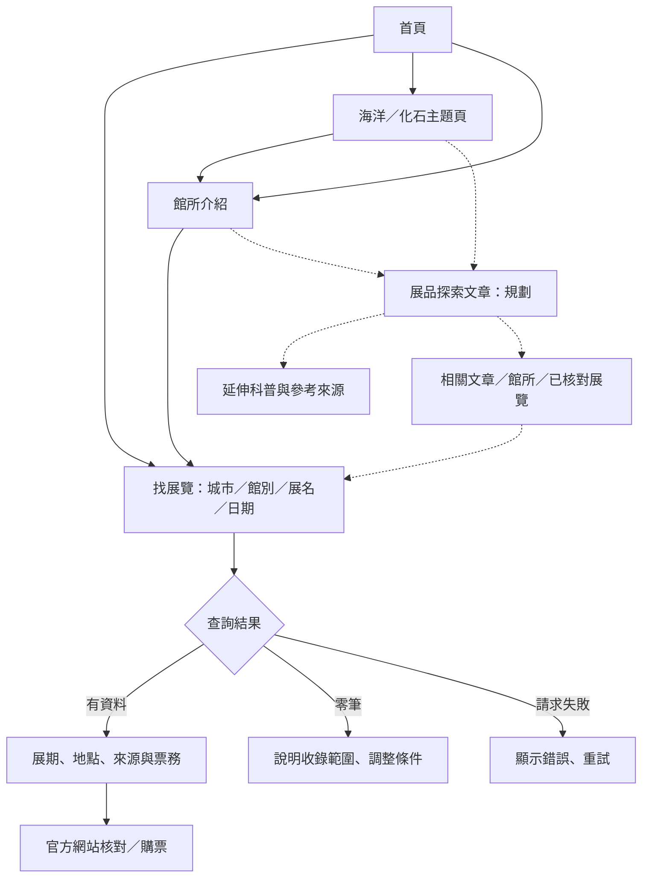
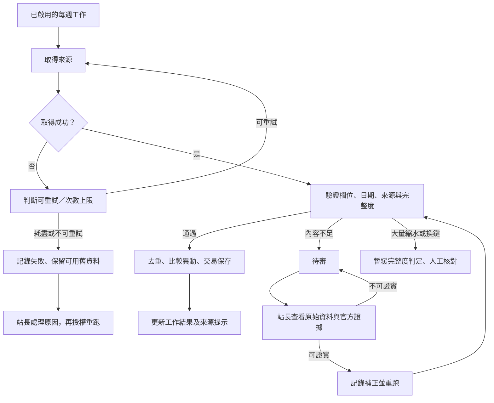
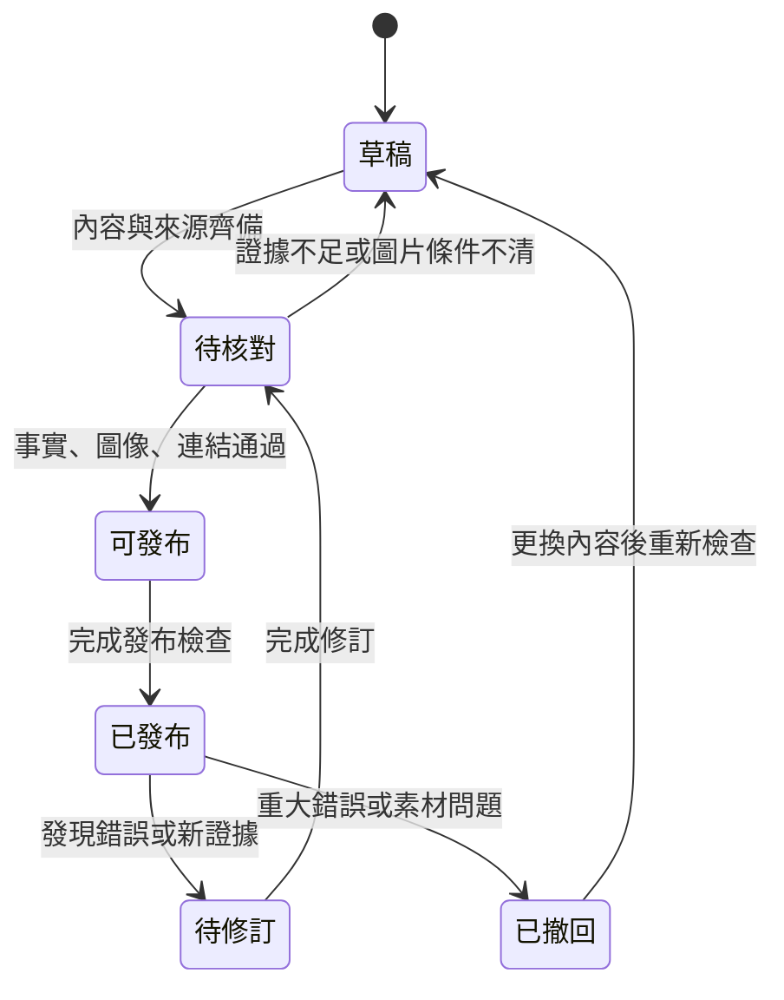

# 產品流程與內容生命週期

2026-10-25｜[產品規格](product-prd.md) · [使用案例與驗收](product-stories.md)。本頁是使用者與營運流程；技術實作圖仍見 [architecture](architecture.md)。虛線表示規劃中的展品文章，不代表已存在頁面。

## 訪客主流程

首頁承擔找展與分流；主題頁承擔分類探索；館所頁承擔行前資訊；文章承擔知識閱讀。沒有確認正在展出的展品，只連館所與科普，不提供虛假的「現在去看」入口。

## 資料更新與站長處理

這是目標行為；國美館個別逾時保留、科博館重試及場次待核對持續性目前有 [已知缺陷](review-2026-10-25-non-seo.md)，不能把流程圖當成已全部驗證。長期待審不因時間自動上架；容量、歸檔與清理依維運規則另行管理，不能在清理時連帶刪除有效資料及必要審查證據。

## 展品文章生命週期（全為規劃）

待修訂的舊版只有在不存在重大誤導時才繼續顯示；重大錯誤先撤回。修訂保留日期、原因與改動範圍。撤回同步移除入口，但不把舊網址導向無關文章；明確說明內容不可用。

## 每週產品改善閉環

檢查同步與網站 → 填寫 [每週成效](weekly-product-review.md) → 分辨真實訪客、站長測試與資料限制 → 選一項問題 → 對應需求與驗收 → 小幅發布 → 下一週比較。以找展、核對與閱讀的實際用途判斷，不只追求停留時間增加。
