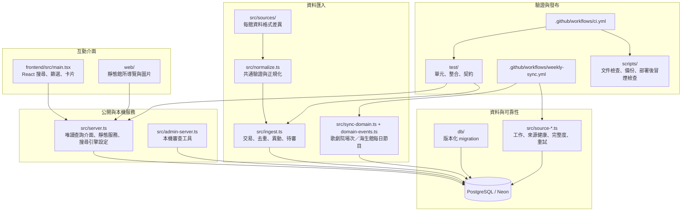

# Event Radar 專案結構地圖

最後盤點：2026-10-20（臺灣時間）。這份地圖描述**目前 Repository 實際存在的檔案與責任**，用於接手、review 與面試講解。產品完成狀態請看[統一進度](../STATUS.md)；資料如何執行請看[目前架構](architecture.md)；重要型別、變數與函式請看[程式導覽](code-reference.md)。

## 先用三條路理解專案

1. **訪客查展覽**：`frontend/src/` 的 React 首頁呼叫 `src/server.ts` 的唯讀查詢介面，再讀 PostgreSQL。
2. **館方資料變成展覽**：`src/sources/` 的館別資料轉換器解析來源，`src/normalize.ts` 統一驗證，`src/ingest.ts` 用交易寫入 PostgreSQL。
3. **固定工作與品質保護**：GitHub Actions 觸發 `src/source-job-cli.ts` 或 `src/sync-domain.ts`；來源清單縮水、格式異常或缺展期時停在待審／失敗紀錄，不直接刪公開資料。



## 資料夾總覽

```text
Event Radar
├─ .github/workflows/         GitHub Actions：CI、每週同步、Pages、奇美只讀檢查
├─ data/                      人工核對或離線使用的來源快照；不是正式資料庫
├─ db/                        PostgreSQL migration，唯一的資料庫結構變更入口
├─ docs/                      規格、設計決策、維運、階段證據與面試說明
├─ frontend/                  React + Vite 首頁原始碼與建置設定
│  └─ src/                    互動介面元件、樣式與 查詢網址工具
├─ postman/                   Postman 手動測試集合
├─ private/                   本機機密設定與備份位置，受 .gitignore 保護
├─ scripts/                   文件檢查、部署後冒煙檢查、資料庫備份／還原工具
├─ src/                       Node + TypeScript 後端、匯入流程與本機 命令列工具
│  └─ sources/                每一來源各自的資料轉換器／解析器
├─ test/                      單元、fixtures、隔離 PostgreSQL 與 HTTP 整合測試
├─ web/                       靜態導覽 HTML、共用 CSS/JS、圖片；React 建置輸出不提交
├─ .env.example               可提交的環境變數範本，沒有真實密碼或 API Key
├─ compose.yaml               本機 PostgreSQL 容器
├─ package.json               唯一的命令入口與 Node 依賴清單
├─ render.yaml                Render 部署設定
└─ README.md / STATUS.md      專案入口與目前完成度
```

`node_modules/` 是安裝產物，`web/react-build/` 是前端建置產物，兩者都不屬於要閱讀或提交的原始碼。`private/` 可放本機憑證與備份，但永遠不可推送。

## 依責任閱讀 `src/`

`src/` 是目前最容易感到雜亂的地方；它在實體上採「同一層的可執行 TypeScript 檔」形式，但可以用下列邏輯群組閱讀。這次先**不大量搬動檔案**，避免破壞 npm scripts、測試、CI 和 Actions；新功能仍應放到相對應群組，而非任意新增入口。

| 邏輯群組 | 主要檔案 | 責任 | 面試時怎麼說 |
| --- | --- | --- | --- |
| 公開服務 | `server.ts` | 唯讀查詢介面、靜態檔、標準網址／搜尋引擎設定、輸入參數檢查 | 前端只拿唯讀資料；資料正確性在匯入時建立，查詢端不猜資料。 |
| 本機管理 | `admin-server.ts`、`review*.ts`、`corrections.ts` | 本機登入後的待審、補正、海生館開館／歌劇院場次人工核對 | 不把敏感寫入 API 暴露給公開網站；人工決策也保留來源證據。 |
| 共通匯入核心 | `normalize.ts`、`ingest.ts`、`dedupe.ts`、`sync-source.ts`、`retry-policy.ts` | 正規化、HTTP 防護、交易、去重、異動、來源別有限重試 | 每館格式不同，但通過同一個 `ExhibitionDraft` 品質閘門。 |
| 工作佇列與來源健康 | `source-jobs.ts`、`source-job-cli.ts`、`source-job-schedule.ts`、`source-health*.ts`、`source-coverage.ts`、`source-missing.ts`、`source-baseline-review.ts` | PostgreSQL `FETCH_SOURCE` 工作、租約、重試、停止重試狀態、成功時間、清單縮水保護 | 工作佇列只負責單一來源工作；不是尚未完成的多階段通知平台。 |
| 不同領域事件 | `sync-domain.ts`、`domain-events.ts`、`performance-session-review.ts`、`marine-opening-review.ts`、`visit-status.ts` | 歌劇院多場次、海生館每日節目與特殊開館狀態 | 不把展期、演出場次、每日節目硬塞成同一個時間欄位。 |
| 專屬資料工具 | `ticketing.ts`、`chimei-programmes.ts`、`import-chimei-programmes.ts`、`refresh-chimei-activities.ts` | 票務人工核對、奇美活動候選快照與本機匯入 | 候選來源與正式特展同步分開，避免誤導使用者。 |
| 資料庫與啟動 | `migrate.ts` | 依序套用 migration、驗證舊資料庫基線 | Schema 只能靠新增 migration 演進，不能手動改線上表。 |
| 來源探測工具 | `check-chimei.ts`、`probe-chimei-source.ts`、`probe-ntmofa.ts` | 對可疑來源做只讀驗證 | 探測成功不等於已承諾為正式、穩定自動來源。 |

### `src/sources/`：來源專屬差異只能留在這裡

| 資料轉換器／檔案 | 資料類型與特例 |
| --- | --- |
| `nmns.ts`、`nmns-api.ts` | 科博館公開資料介面／公開 JSON，檢查 API 回傳、日期與館方網址。 |
| `npm-south.ts`、`npm-north.ts` | 故宮南院 HTML、北院公開 JSON；處理民國年、院區與展期。 |
| `nmmba.ts`、`nmmba-detail.ts` | 海生館特展公開資料與需要官方詳情佐證的日期。 |
| `nstm.ts` | 科工館 JSON 加官方列表交叉驗證。 |
| `ntmofa.ts` | 國美館頁面，以及藝術家、策展人、展區、樓層、相關活動。 |
| `ntt-events.ts` | 臺中國家歌劇院節目與多個場次。 |
| `nmmba-programmes.ts` | 海生館指定觀察日的餵食／解說時段。 |
| `chimei-*.ts`、`moc-chimei.ts` | 奇美候選／快照與文化部補充；不把內部端點稱作公開 API。 |
| `official-html.ts` | 受限大小、逾時與官方主機檢查的共用 HTML 讀取。 |

資料轉換器的輸出必須回到 `ExhibitionDraft`、`PerformanceEvent` 或 `MarineProgramme`。`specialEvent`、`expoEvent` 這類館方私有欄位不應流入 API、資料庫共通模型或 React 元件。

## 資料庫 `db/` 怎麼讀

| 範圍 | Migration | 用途 |
| --- | --- | --- |
| 基本特展與追溯 | `001`–`014` | 博物館、展覽、來源紀錄、待審、補正、異動、同步嘗試與來源工作。 |
| 藝術／表演／海洋領域 | `015`–`025` | 國美館專屬欄位、歌劇院場次、海生館每日時段／開館資訊、來源縮水與身份鍵保護。 |

新的 schema 變更新增一個編號遞增的 SQL 檔；不能重寫既有 migration。關係和索引見[ERD](erd.md)。

## 前端、靜態頁與圖片的分界

| 區域 | 檔案 | 用途 |
| --- | --- | --- |
| React 首頁 | `frontend/src/main.tsx` | 搜尋、城市與館所連動、展覽卡、票務、來源狀態、深海與化石區入口。 |
| React 領域元件 | `DomainProgrammes.tsx`、`FossilExpedition.tsx` | 表演／海生館節目與化石圖鑑的互動顯示。 |
| 網址安全 | `runtime-url.ts` | GitHub Pages 靜態前端可安全指向 Render 查詢介面。 |
| 外觀 | `styles.css` | 考古主視覺、響應式版面、讀取動畫與回頂／快速跳轉。 |
| 靜態館所導覽 | `web/guides/` | 每館單獨 HTML；適合人工介紹、照片署名與官方連結。 |
| 靜態素材 | `web/assets/` | 圖片與共用資源；授權與出處在 `web/photo-credits.html`。 |

首頁資料來自公開 API；館所導覽與圖鑑大多是人工核對的靜態內容。兩者不可互相宣稱為自動更新資料。

## 驗證與部署檔案

| 位置 | 何時跑 | 保護什麼 |
| --- | --- | --- |
| `test/*.test.ts`、`test/*.test.mjs` | `npm test` | 解析器、正規化、去重、異動、健康與領域資料規則。 |
| `test/ingest.integration.cjs` | `npm run test:integration` | 隔離 PostgreSQL 匯入、公開 HTTP 查詢介面、OpenAPI 回應契約。 |
| `.github/workflows/ci.yml` | push／PR | 文件連結、型別、單元、整合、備份還原驗證。 |
| `.github/workflows/weekly-sync.yml` | 手動或每週二 | 每館獨立同步；以 GitHub Secrets 的連線資訊寫入 Neon。 |
| `.github/workflows/pages.yml` | `main` push | 建置並發布 GitHub Pages React 介面。 |
| `scripts/check-docs.mjs` | `npm run check:docs` | README、STATUS 與 `docs/` 的本機相對連結。 |
| `scripts/smoke-deploy.mjs` | `npm run smoke:deploy` | 部署後健康與主要 API。 |
| `scripts/db-backup.mjs` | `backup:db`、`restore:check` | PostgreSQL 備份、雜湊、隔離資料庫還原演練。 |

## 面試或接手時的閱讀順序

1. [README](../README.md)：產品邊界與本機啟動方式。
2. 本頁：先找到每個資料夾的責任。
3. [程式導覽](code-reference.md)：看最重要的型別、變數與函式。
4. [目前架構](architecture.md)與[ERD](erd.md)：把程式角色連成資料流。
5. `src/normalize.ts` → `src/sources/nmns.ts` → `src/ingest.ts`：完整看一次「單館特展」流程。
6. `src/source-jobs.ts` → `.github/workflows/weekly-sync.yml`：看來源工作如何排入與執行。
7. `src/sources/ntt-events.ts` → `src/domain-events.ts`：看為何表演場次另建模型。
8. `test/` 與 [技術難點報告](technical-challenges-report.md)：看規則如何被驗證、取捨如何留下證據。

## 後續整理原則

- 新增正式館方來源：先新增或擴充 `src/sources/<source>.ts`，再接到 `src/ingest.ts`／`sync-domain.ts`，最後補資料轉換器測試、來源文件與狀態。
- 新增公開資料欄位：先確認它是共通欄位還是領域專屬欄位；必要時新增 migration 和 公開介面契約／React 型別，不能只改前端。
- 新增一次性命令：若只為診斷，使用清楚的 `*-cli.ts` 或 `probe-*.ts` 名稱；若會變更資料，記錄審核者、證據與結果。
- 需要真的重整實體目錄時，應拆成獨立 PR：先移動檔案、更新 import／scripts／測試，再跑完整 CI。不要在功能修改中順手大搬家。

## `src/` 完整檔案索引

下表讓你從檔名就能回到邏輯群組；同一群組內的 `*-cli.ts` 是人手執行的命令入口，非 `*-cli.ts` 多半是可被測試與其他模組匯入的服務函式。

| 類別 | 檔案 | 一句話用途 |
| --- | --- | --- |
| 公開／管理入口 | `server.ts`、`admin-server.ts` | 公開唯讀查詢介面 與僅限本機的管理／審查頁。 |
| 主要匯入 | `ingest.ts`、`normalize.ts`、`dedupe.ts`、`sync-source.ts`、`sync-status.ts`、`retry-policy.ts` | 限期展覽取得、正規化、寫入、比對、同步紀錄與有限重試。 |
| Migration | `migrate.ts` | 檢查並依序套用 `db/` SQL。 |
| 來源工作 | `source-jobs.ts`、`source-job-cli.ts`、`source-job-schedule.ts` | 工作佇列的入列、領取、完成、重播和排程執行。 |
| 來源品質 | `source-coverage.ts`、`source-missing.ts`、`source-baseline-review.ts`、`source-baseline-review-cli.ts` | 清單縮水、缺席候選與人工接受新基準。 |
| 健康狀態 | `source-freshness.ts`、`source-health.ts`、`source-health-report.ts` | 將成功時間、失敗與待審量變成健康狀態。 |
| 人工審查 | `review.ts`、`approve-review.ts`、`review-service.ts`、`missing-review-service.ts`、`corrections.ts` | 列出待審、附證據核准與保存補正。 |
| 表演／海洋領域 | `sync-domain.ts`、`domain-events.ts`、`performance-session-review.ts`、`review-performance-session-cli.ts`、`marine-opening-review.ts`、`review-marine-opening-cli.ts`、`visit-status.ts` | 多場次、每日節目、開館資訊和人工核對。 |
| 科博館輔助 | `nmns-api.ts` | 封裝科博館 Key 與特定 API path。 |
| 票務／奇美候選 | `ticketing.ts`、`chimei-programmes.ts`、`import-chimei-programmes.ts`、`refresh-chimei-activities.ts` | 人工票務設定及奇美候選活動快照。 |
| 來源探測 | `check-chimei.ts`、`probe-chimei-source.ts`、`probe-ntmofa.ts` | 唯讀檢查來源是否可解析，不直接宣告為正式同步。 |

`src/sources/` 的完整資料轉換器索引：`official-html.ts`（安全讀取 HTML）、`nmns.ts`、`npm-south.ts`、`npm-north.ts`、`nmmba.ts`、`nmmba-detail.ts`、`nstm.ts`、`ntmofa.ts`（特展）；`ntt-events.ts`（表演）；`nmmba-programmes.ts`（海洋每日節目）；`chimei.ts`、`chimei-activities.ts`、`chimei-internal.ts`、`fetch-chimei-public.ts`、`moc-chimei.ts`（奇美候選／文化部補充）。

## 可規劃但尚未執行的實體目錄重整

目前先用本文件建立邏輯分類；如果之後確實要移動程式，建議分開做一個只調整路徑的重構版本，目標如下。這不是目前實際結構，不能在面試時說成已完成。

```text
src/
├─ api/             server.ts、公開回應與 query 檢查
├─ admin/           admin-server.ts、review、corrections
├─ ingestion/       ingest、normalize、dedupe、sync-source、sources/
├─ jobs/            source-jobs、retry、health、coverage
├─ domains/         domain-events、performance、marine、visit-status
├─ db/              migrate
└─ cli/             *-cli.ts、probe-*.ts、一次性操作命令
```

實作時必須一併更新 `package.json`、所有 import、`test/`、GitHub workflow 和文件，再跑 `npm run typecheck`、`npm test`、`npm run test:integration`。這樣能得到較乾淨的目錄，但不應為了美觀在準備面試或修功能時冒部署風險。
