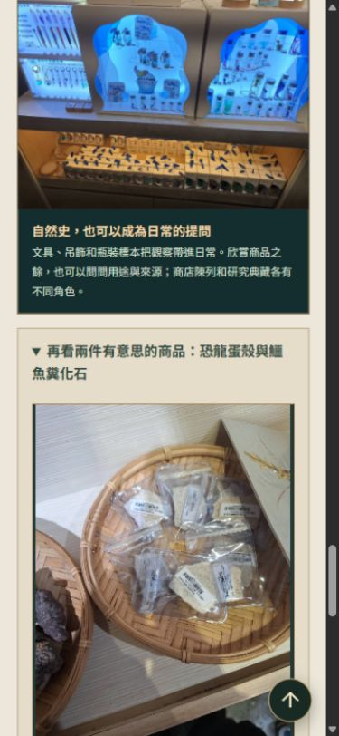

# 2026-10-26｜審查缺陷修正與左鎮參觀科普

本階段完成本機程式與內容，尚未推送、合併或部署；正式資料庫未變更。對應 [審查報告](review-2026-10-25-non-seo.md)、[產品優先級](product-mvp.md)的 REL-01～03，以及 ER-104／105。

## 可靠性修正

| 原問題 | 修改與決策 | 回歸證據 |
| --- | --- | --- |
| 缺少前端檔案引發二次標頭錯誤 | 先讀檔才送標頭；ENOENT 回404；已送標頭的錯誤中止該回應 | 真實 HTTP 連續請求不存在 JS／CSS，再請求健康檢查仍成功 |
| 閒置資料庫連線斷線退出 | 公開／本機管理服務註冊 pool error；僅寫固定訊息，失效 client 由 pg-pool 移除 | 單元事件測試；隔離 DB 用 pg_terminate_backend 只中斷測試服務專屬 application_name，下一次健康檢查重新連線成功 |
| 國美館單筆詳情暫時失聯隱藏舊展 | 來源紀錄加本次 preserveExisting 旗標；待審保留，但不下架既有展；官方批次標 deferred_partial，不刷新完整成功時間或完整度基準 | 離線模擬官方清單：完整批次 → 缺一頁詳情 → 舊展仍顯示、待審1、完整官方時間不變；成功取得但矛盾標題仍隔離 |
| 場次重複匯入恢復正常 | 舊人工結果失效後 unknown 遇到來源 scheduled 繼續保守保留；其他來源明確狀態或人工重新核對可解除 | 首次版本變更為 unknown，第二次同版匯入仍 unknown 且沒有偷偷恢復狀態或多寫異動 |
| 科博館暫時失敗沒有重試 | SourceRequestError 使用固定 SOURCE_TRANSIENT／SOURCE_PERMANENT 前綴，讓子程序輸出可供既有重試入口辨識；不輸出原始請求錯誤及含Key網址 | 網路、讀取中斷、429、503可重試；403、破損JSON不可重試；錯誤訊息不含測試金鑰 |

preserveExisting 是單次來源判讀，沒有新增 DB 欄位；下次重新取得內容會重新分類。內容驗證失敗仍需隔離；一批全無合格內容時繼續停止，不宣稱同步成功。部分成功批次可保存合格資料，但必須呈現涵蓋限制。

場次的 scheduled 在現有來源中不構成足以解除異動疑慮的明確復演證據，因此 unknown 採保守保留；這會增加人工覆核需求。既有被誤改為 scheduled 的正式資料不會由此自動辨識或修復，需要另外核對。

驗證：85項單元測試、前後端型別、前端建置、完整隔離 PostgreSQL 18／HTTP／OpenAPI 整合通過。整合測試使用本機 127.0.0.1:55439 的臨時庫，不讀寫 Neon；臨時測試資料庫由測試結束程序移除。沒有新增 migration。第二次真實週排程仍待10/27觀察，本階段未重跑線上工作。

## 照片選用與科普

原圖在相鄰工作目錄 event-radar/左鎮化石館，四張JPEG合計約0.92MB；完整副本保存在本專案 web/assets，沒有生成、調色或替換商品外觀。版面依螢幕顯示尺寸，附替代文字、寬高與延後載入。

| 原檔 | 選用 | 圖片用途與界線 |
| --- | --- | --- |
| 75587.jpg | 商品主圖 | 瓶裝標本、文具、吊飾，以觀察問題作入口，不辨識瓶內物種 |
| 75586.jpg | 陳列補圖 | 藍色櫃面與商品範圍，不抄錄價格或庫存 |
| 75588_0.jpg | 展開閱讀 | 使用者確認為化石先生販售的恐龍蛋殼；名稱來自提供者，無獨立標本鑑定 |
| 75589_0.jpg | 展開閱讀 | 使用者確認為鱷魚糞化石；商品身份與一般科普敘述分開 |

先前五張HEIC為服飾、玻璃珠、金屬飾物及天花圖紋；目前只保留本機檢視副本，不誤放到商品區，也未上傳原檔。參觀商品照片的拍攝日期未取得，不以匯入日冒充拍攝日。照片來源說明已加入 web/photo-credits.html。

左鎮館所頁新增「看骨架的小線索」及「看展後的小發現」；科博館頁新增恐龍骨盆觀察並內鏈回左鎮奇偶蹄段落。蛋殼／糞化石照片用 details 展開，減少首次閱讀負擔。這是館所介紹的短篇延伸，不等於完成PRD中的三篇獨立展品文章、文章發布系統或閱讀事件。

## 主張與來源對照（2026-10-26查閱）

| 主張 | 來源與編輯限制 |
| --- | --- |
| 馬、犀牛為奇蹄類；牛、鹿、豬為偶蹄類的例子 | 科博館張鈞翔〈[畫說奇蹄動物](https://libknowledge.nmns.edu.tw/nmns/lib/PDF/91/173/05.htm)〉；只作入門，骨架缺失不靠表面數趾判定 |
| 貘前足四趾，不是所有奇蹄動物每隻腳都奇數趾 | [新竹市立動物園](https://zoo-info.hccg.gov.tw/%E5%A5%87%E8%B9%84%E7%9B%AE%E5%92%8C%E5%81%B6%E8%B9%84%E7%9B%AE%E5%8B%95%E7%89%A9/)；不照搬「更進化／更成功」等單線演化解釋 |
| 傳統蜥臀、鳥臀差異關注骨盆排列及恥骨方向 | [西澳博物館](https://museum.wa.gov.au/explore/dinosaur-discovery/dinosaur-types/index.html)；不說成恥骨分開／合併 |
| 鳥類屬獸腳類，在傳統框架屬蜥臀類；不能只憑恥骨方向判斷所有物種 | [美國國家公園署](https://www.nps.gov/subjects/fossils/major-groups-of-dinosaurs.htm)；另以[古生物學研究](https://onlinelibrary.wiley.com/doi/10.1111/pala.12362)核對非鳥臀類也可有後轉恥骨，不把傳統二分當成全部系統演化定論 |
| 蛋殼結構可提供辨識線索 | [美國自然史博物館：化石辨識](https://www.amnh.org/research/paleontology/fossil-identification)；無法由商品照判種或年代，更不能宣稱本地出土 |
| 糞化石是生痕化石，可保留食性線索，但生產者常難確定 | [倫敦自然史博物館](https://www.nhm.ac.uk/discover/what-is-a-coprolite.html)；商品的「鱷魚」名稱未獨立驗證 |

外部來源僅引用與連結，自行撰寫中文說明，沒有下載外站圖片。網站未新增商品購買連結、合作或分潤宣稱。

## 瀏覽器驗收

本機預覽4113：左鎮頁四張商品圖均完成載入，details可展開；桌面預設999px及390px手機模擬寬度皆無橫向溢出。科普與來源入口可見。這是瀏覽器尺寸模擬，不是手機實機驗收。四張JPEG另經公開服務HTTP整合檢查，確認200、image/jpeg與檔頭，避免以錯誤HTML冒充圖片。

文件連結檢查79份通過；差異格式檢查通過。獨立測試資料庫已由測試移除；本機預覽保留供使用者查看。
