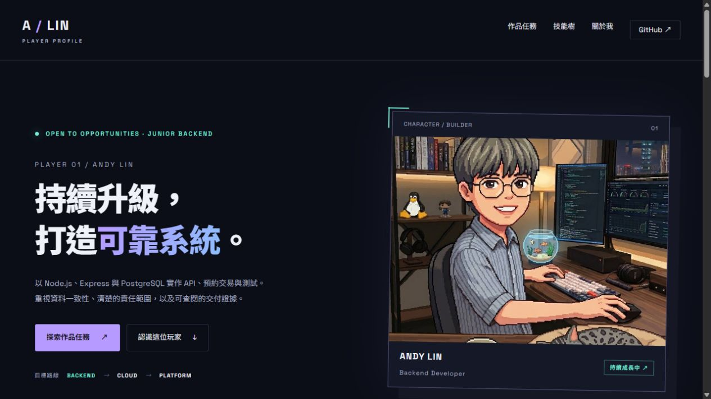

# 展館雷達｜三種使用者角色測試

日期：2026-10-24。網站：[公開快速前端](https://andylinstrongtyping.github.io/event-radar/)及[館所介紹服務](https://event-radar-preview.onrender.com/)。

**後續處理（同日）**：已修正深海錯誤連結與歷史快照用語，空結果／長等待文案也已調整，前端仍待發布驗收。奇美正式庫原本無展覽、待審及匯入批次；核對官網後，已用人工來源匯入《埃及之王：法老》一筆，公開 API 查得 `total=1`、`sourceStatus=curated`。以下各角色表格保留修正前的操作觀察，勿視為修正後的新測試。

## 測試方式與限制

本次由三個獨立 AI 工作階段分別模擬「常看展覽者」「一般臺灣民眾」「教師／研究人員」，先操作網站，再回報可見事實。**不是招募三位真人，也不能把心得當作真實訪談、滿意度或轉換率證據。**

三個工作階段均回傳部分操作觀察，之後因使用額度限制中斷，沒有完成獨立最終報告。主工作階段接著實際補測搜尋、詳情、館所介紹、海洋／化石切換與錯誤跳轉。下方明確標記證據來源；模擬心得為依任務整理的判斷，不是受訪者原話。

使用桌面瀏覽器，未驗收手機實機、鍵盤全流程、購票、登入或第三方網站全部功能。沒有修改產品程式、資料庫或部署。瀏覽可能被既有 GA4 記錄，屬測試流量，不可計作新增真實使用者。

## 1. 常看展覽的人

任務：找臺南／臺中的當期特展，確認展期、票價與官方入口，再探索其他主題。

| 證據來源 | 實際操作與觀察 | 結果 |
| --- | --- | --- |
| 獨立角色 | 選臺南市、展出中、重新查詢；曾等待「正在發掘檔案…」，之後顯示 0 場，其他專區已有內容 | 沒有完成選展；當時原因未明 |
| 主工作階段補測 | 暖機後選臺中市、未結束、不限票價，顯示 8 場：7 場展出中、1 場即將開始；館所選單只有科博館與國美館 | 成功找到候選展覽 |
| 主工作階段補測 | 展開「看見你我他牠它：健康一體的行動密碼」，看到 2026-05-27～2027-02-28、地球環境廳 1F 第一特展室、10/20 資料更新時間 | 展期與展區可查 |
| 主工作階段補測 | 同卡片顯示「本展票價尚未核對」，一般展示場全票 NT$120 並明說不代表本展票價；有官方頁、一般票價及購票入口 | 有核對入口，不能直接在本站完成特展預算判斷 |
| 主工作階段補測 | 臺南／奇美、不限票價、展出中仍為 0；改全部展覽亦為 0。來源面板顯示「人工核對資料；請查館方最新公告」 | 需另查來源與查詢資料，不能推論館方沒有展覽 |

模擬心得：適合先找展名與日期，但卡片摘要多為「前往官方頁面查看展覽介紹與參觀資訊」，較難快速比較哪場值得看。可保留官方核對原則，逐步補有來源支持的短摘要；沒有可靠資料時不要讓 AI 編造。

## 2. 一般臺灣民眾

任務：不知道館名，想找臺中免費活動，查開館時間與交通，能在長頁面切換主題。

| 證據來源 | 實際操作與觀察 | 結果 |
| --- | --- | --- |
| 獨立角色、主工作階段各自觀察 | 臺中＋明確標示免費顯示「找到 0 場特展」「這片地層暫無線索」，有放寬條件提示與「清除篩選」 | 零結果有處理，但無法完成免費選展 |
| 主工作階段補測 | 開科博館介紹，先出現 Render「SERVICE WAKING UP／APPLICATION LOADING」，後續載入正常介紹 | 可用但有中途等待；本次未精確計時 |
| 主工作階段補測 | 找到週二至週日 09:00–17:00、週一例休、特殊日查官方；時間核對日 10/10 | 成功找到一般開館資訊，不等同指定日開館保證 |
| 主工作階段補測 | 找到交通區，選臺中市作出發地，介面說明城市政府只是示意起點，提供交通路線按鈕及官方交通連結 | 成功找到入口；未測 Google Maps 實際路線 |
| 主工作階段補測 | 切換沖繩及左鎮，內容與館名會更新；深海返回全部展覽的連結卻跳出本站 | 主題切換成功，返回搜尋有錯誤 |

模擬心得：有圖片和主題可逛，適合找出遊靈感。對只想快速決定去哪裡的人，「查詢基準日」與多段資料說明較費理解；可改成貼近任務的提示，但不要抹除資料限制。零結果應說「本站目前沒有符合條件的已收錄資料」，避免被誤解成整個城市沒有免費活動。

## 3. 教師／研究人員

任務：用海洋或化石資料規劃參訪，區分展覽、每日節目與常設介紹，確認來源與圖片性質。

| 證據來源 | 實際操作與觀察 | 結果 |
| --- | --- | --- |
| 獨立角色、主工作階段各自觀察 | 海生館分成展覽、餵食與定點解說、生物圖鑑；當日節目標示觀察日 2026-10-17，並說不是今天節目保證 | 資料類型與時間界線清楚 |
| 獨立角色、主工作階段各自觀察 | 白鯨圖片明標攝於加拿大、非海生館；鉤吻鮭標武陵野外照；都有照片來源與館方介紹入口 | 能區分示意與館內紀錄 |
| 主工作階段補測 | 海生館顯示「重返海洋」「海洋性別變奏曲」的完整展期及核對館方入口；每日紀錄列 9 種節目與場次 | 可做初步整理，未逐一核驗館方今天的安排 |
| 主工作階段補測 | 沖繩明標 10/16 人工核對、未自動匯入、日本當地時間；常設區有樓層與官方連結 | 可分辨資料性質 |
| 主工作階段補測 | 化石區標靜態導覽，澎湖布氏鯨骨骼明說不是化石，左鎮可讀展區與歷史展件照片 | 科普界線有交代 |

模擬心得：適合作為教學參訪的資料入口與線索整理，但研究引用仍應回到館方原始資料。優點是來源、核對日和照片界線；問題是海生館雖顯示歷史日期，下一段仍寫「先打開今日的第一批觀察紀錄」，需要一致用語。

## 4. 優先處理清單

### P1：深海返回搜尋連結離開本站（已修程式，待公開驗收）

1. 在 GitHub Pages 公開前端進深海探勘，選海生館。
2. 按「使用狀態篩選查看海生館全部展覽」。
3. 實際抵達 `https://andylinstrongtyping.github.io/?museum=nmmba#explore-title`，畫面是「A / LIN PLAYER PROFILE」個人作品集。

原因可在[海洋專區程式](../frontend/src/DomainProgrammes.tsx)第 257 行對到硬寫的根目錄連結 `/?museum=nmmba#explore-title`，未使用專案的[前端網址處理函式](../frontend/src/runtime-url.ts)。

建議修復時讓連結保留 `/event-radar/` 子路徑，並同時測試根目錄部署及子路徑部署。這是確認的功能錯誤，不是主觀風格問題。

### P1 已定位並補一筆：奇美／臺南搜尋沒有候選展覽

角色觀察與補測均顯示 0 筆，補測「全部展覽」仍然為 0。後續公開 API 亦回 0；唯讀查正式 Neon 發現奇美展覽、來源待審及匯入批次全部為空，並非原有展覽被日期篩掉或刪除。核對館方詳情後，以人工來源匯入一筆《埃及之王：法老》，公開 API 再查得一筆 `curated`。仍未建立奇美完整新展發現或自動同步。

### P2：等待期間不足以理解發生什麼事

首頁可先看圖片與靜態內容，動態資料仍可能等待；介紹頁曾直接顯示 Render 啟動畫面。建議長等待時補清楚文字、官方入口或有限重試選項，不應只持續播放發掘動畫。單次操作不足以推算可用率或平均載入時間。

### P2：歷史節目中的「今日」文案

[海洋專區程式](../frontend/src/DomainProgrammes.tsx)第 70 行「今日的第一批觀察紀錄」與 10/17 歷史快照容易衝突，建議改為「這次觀察紀錄」或直接帶入觀察日期。上方已存在警語，但正文也應一致。

### P2：零結果與預算判斷的資訊缺口

免費篩選是「明確標示免費」而非免費活動全集，0 筆本身不是程式錯誤。建議零結果再次說明涵蓋界線，並提供取消免費條件／館所介紹入口。特展價格未知時保持未知，不用一般入館價格冒充；優先人工補最常被看的展覽資訊。

## 5. 本輪結論與後續驗收

目前最強的是主題探索、來源標示及行前資訊入口；最需要補的是從「感興趣」走到「決定看哪場」的連續流程。先修已重現的錯誤連結、診斷奇美零結果，再調整等待與歷史日期文案，比立即新增專區更有價值。

後續真正招募真人時，可沿用三組任務，各請一位實際使用者自行操作，記錄是否完成、在哪裡停住、是否需要提示。不要把本報告的主觀模擬心得改寫成真人推薦或使用滿意度。

本次報告與截圖保留修正前證據。後續已定位奇美零結果並補一筆人工核對展覽，也已修改前端，但尚待 Pages 發布與公開頁回歸。未取得完整三份獨立心得，未進行手機實機測試，也未證明奇美完整涵蓋；這些仍是驗證界線。
